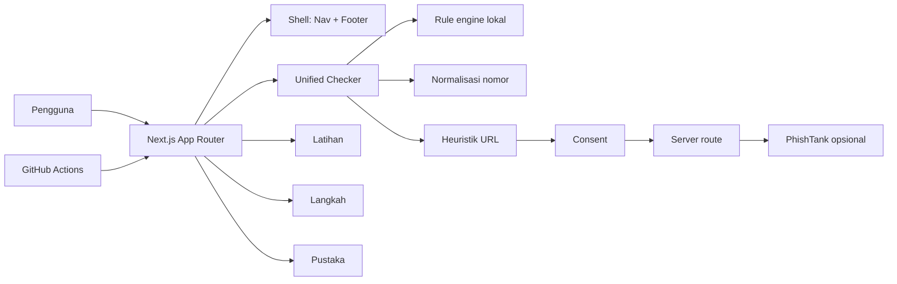

# Saring — Pendamping Kepercayaan Digital

> **Berhenti sebentar. Periksa sinyalnya.**
> Belum tentu penipuan. Belum tentu aman. Kenali tandanya sebelum bertindak.

Saring adalah aplikasi web yang membantu anak muda Indonesia mengenali pesan
penipuan daring, memeriksa sinyal URL dengan opsi reputasi PhishTank setelah
consent, menormalisasi nomor, berlatih mengambil keputusan yang lebih aman, dan
memahami langkah selanjutnya — tanpa akun dan tanpa layanan AI eksternal.


---

## Daftar isi

1. [Masalah dan tujuan](#masalah-dan-tujuan)
2. [Target pengguna](#target-pengguna)
3. [Fitur](#fitur)
4. [Tumpukan teknologi](#tumpukan-teknologi)
5. [Arsitektur](#arsitektur)
6. [Sistem deteksi heuristik](#sistem-deteksi-heuristik)
7. [Privasi dan penanganan data](#privasi-dan-penanganan-data)
8. [Menjalankan secara lokal](#menjalankan-secara-lokal)
9. [Perintah kualitas](#perintah-kualitas)
10. [Deployment](#deployment)
11. [Keterbatasan yang diketahui](#keterbatasan-yang-diketahui)
12. [Atribusi dan lisensi](#atribusi-dan-lisensi)
13. [Tautan](#tautan)

---

## Masalah dan tujuan

Penipuan digital semakin mahir memanfaatkan rasa takut, desakan, janji
berlebihan, dan peniruan pihak resmi. Korban sering kali bertindak sebelum
sempat memeriksa. Saring lahir dari premis sederhana: **keputusan menjadi lebih
aman ketika orang berhenti sejenak dan memeriksa sinyalnya.**

Aplikasi ini adalah **alat bantu pengambilan keputusan**, bukan hakim yang
memutuskan bersalah-tidaknya sebuah pesan. Hasilnya transparan, dapat
dijelaskan, dan disertai langkah lanjutan yang praktis.

## Target pengguna

- Pelajar dan mahasiswa Indonesia.
- Pencari kerja muda (lowongan palsu, biaya rekrutmen).
- Pengguna layanan digital sehari-hari (bank, e-wallet, marketplace).
- Siapa pun yang ingin lebih teliti sebelum membalas pesan mencurigakan.

## Fitur

### 1. Periksa — triase ancaman digital yang dapat dijelaskan

Fitur utama. Pengguna menempelkan pesan, lalu mesin aturan heuristik
menjelaskan sinyal bahaya yang ditemukan, lengkap dengan kategori, tingkat
keparahan, bukti teks, dan langkah selanjutnya.

Hasil dikelompokkan menjadi tiga (tidak pernah "aman"):

- **Banyak sinyal bahaya**
- **Perlu diperiksa lebih lanjut**
- **Sinyal yang ditemukan masih terbatas**

### 2. Latihan — simulator keputusan interaktif

Delapan skenario fiktif (lowongan palsu, permintaan OTP, tautan mencurigakan,
peniruan, janji investasi, undian, pemulihan akun, permintaan transfer). Setiap
pilihan langsung diberi umpan balik beserta alasannya, dan diakhiri ringkasan
belajar berdasarkan jawaban pengguna.

### 3. Langkah — panduan tindakan terpersonalisasi

Enam situasi berbeda (menerima pesan mencurigakan, mengklik tautan, memasukkan
kata sandi/OTP, sudah transfer, akun diambil alih, membagikan dokumen pribadi)
dengan daftar langkah terprioritas, daftar penyimpanan bukti, dan sumber resmi
(OJK).

### 4. Pustaka — pustaka edukasi ringkas

Panduan singkat yang dapat dicari: bahasa manipulatif, verifikasi lewat saluran
terpisah, lowongan palsu, melindungi kredensial, memeriksa URL, verifikasi
legalitas investasi, dan menyimpan bukti.

## Tumpukan teknologi

- **Next.js 16** (App Router, dijalankan sebagai server Node.js)
- **React 19** dan **TypeScript** (mode `strict`)
- **Tailwind CSS 4**
- **Lucide React** untuk ikon
- **Vitest** + **React Testing Library** untuk pengujian unit/komponen
- **Playwright** untuk pengujian end-to-end
- **ESLint** dan `tsc --noEmit` untuk kualitas kode
- **GitHub Actions** untuk CI
- **Heroku** (Node.js buildpack) untuk deployment

## Arsitektur



Pesan dan heuristik URL berjalan lokal. Lookup URL ke PhishTank hanya terjadi setelah persetujuan eksplisit; nomor belum memiliki provider reputasi gratis yang diaktifkan.


```
app/            rute dan titik masuk aplikasi (App Router)
components/     komponen UI bersama dan khusus fitur
lib/analysis/   mesin aturan, tipe, dan pemeriksaan URL (logika domain murni)
data/           contoh fiktif, skenario, panduan, dan pustaka edukasi
tests/          pengujian unit, komponen, dan e2e
docs/           dokumentasi teknis
```

Logika domain (`lib/analysis`) sepenuhnya **murni dan deterministik** — tidak
ada pemanggilan jaringan — sehingga dapat diuji tanpa peramban. Komponen UI
hanya memanggil fungsi tersebut dan menampilkan hasilnya.

Lihat [docs/ARCHITECTURE.md](docs/ARCHITECTURE.md) untuk penjelasan lebih rinci.

## Sistem deteksi heuristik

Mesin aturan menilai pesan berdasarkan tujuh kategori sinyal:

1. **Pencurian kredensial** — permintaan OTP, PIN, kata sandi, atau kode verifikasi.
2. **Desakan & intimidasi** — ancaman pemblokiran akun atau tenggat sempit.
3. **Permintaan pembayaran di muka** — biaya rekrutmen/administrasi/klaim.
4. **Janji tidak realistis** — untung pasti, tanpa risiko, iming-iming hadiah.
5. **Tautan mencurigakan** — penyingkat URL, alamat IP mentah, atau `http://`.
6. **Indikasi peniruan pihak resmi** — klaim otoritas atau domain mirip resmi.
7. **Instruksi percakapan berisiko** — pindah kanal atau melewati verifikasi.

Setiap aturan memiliki bobot (tinggi/sedang/rendah = 40/25/15). Skor sinyal
dijumlahkan (maksimum 100) dan dipetakan ke klasifikasi.

Ketentuan penting:

- Aturan **memperhatikan konteks**. Menyebut kata "OTP" dalam konteks edukasi
  (mis. *"jangan pernah bagikan OTP"*) tidak ditandai sebagai permintaan
  kredensial; dibutuhkan kata kerja permintaan di dekatnya.
- Tidak semua domain asing, ejaan tidak lazim, URL `http`, atau pesan asing
  otomatis dicap penipuan.
- **Skor bukan peluang penipuan.** Angka ini hanyalah total bobot indikator
  yang dikenali oleh aturan heuristik — bukan probabilitas statistik.

Setiap temuan menampilkan judul, penjelasan, kategori, tingkat keparahan, bukti
teks (bila ada), dan langkah praktis berikutnya. Hasil selalu menyertakan
pengingat:

> Tidak ditemukannya sinyal bahaya bukan berarti pesan ini aman. Analisis ini
> menggunakan aturan heuristik dan dapat melewatkan pola penipuan maupun
> menandai pesan yang sebenarnya sah.

## Privasi dan penanganan data

| Input | Pemrosesan | Dikirim keluar | Penyimpanan |
|---|---|---|---|
| Pesan | Browser | Tidak | Memori sementara |
| URL heuristik | Browser | Tidak | Memori sementara |
| URL reputasi | Route server setelah consent | PhishTank | Tidak disimpan aplikasi |
| Nomor | Browser | Tidak pada mode default | Memori sementara |


Privasi adalah persyaratan produk, bukan fitur tambahan:

- Analisis pesan berjalan **sepenuhnya di peramban** melalui aturan deterministik lokal.
- Pesan yang ditempelkan **tidak pernah** dikirim ke server, penyedia AI, layanan
  analitik, log, atau pihak ketiga.
- Isi pesan **tidak disimpan** di `localStorage`, `sessionStorage`, cookie, database,
  atau log.
- Tidak ada pelacakan/analitik secara bawaan.
- Tidak diperlukan akun, email, nomor telepon, atau data pribadi.

Lihat [docs/SECURITY-AND-PRIVACY.md](docs/SECURITY-AND-PRIVACY.md) untuk detail,
termasuk kebijakan header keamanan dan variabel lingkungan.

## Menjalankan secara lokal

Prasyarat: **Node.js 22** dan **npm**.

```bash
npm install
npm run dev
```

Buka http://localhost:3000.

> Catatan: pada mode pengembangan (`next dev`), header CSP tidak aktif karena
> runtime pengembangan membutuhkan `eval`/inline script. CSP aktif pada build
> produksi (`next start`).

## Perintah kualitas

```bash
npm run lint        # ESLint
npm run typecheck   # tsc --noEmit
npm run test        # Vitest (unit + komponen)
npm run test:e2e    # Playwright (membangun & mengetes server produksi)
npm run build       # produksi build (next build)
```

## Deployment

Target deployment adalah **Heroku** (Node.js buildpack resmi), bukan static
export. Aplikasi dijalankan sebagai server Node.js.

Ringkasan langkah (lihat selengkapnya di [docs/DEPLOYMENT.md](docs/DEPLOYMENT.md)):

1. Pastikan akun Heroku memiliki CLI (`heroku login`).
2. `heroku create saring-app` (nama disesuaikan).
3. `git push heroku main` — Heroku mendeteksi `heroku/nodejs`, menjalankan
   `npm ci` (lockfile `package-lock.json`) lalu `npm run build`.
4. `web: npm start` (terbaca dari `Procfile`) menyajikan `next start` yang
   menyesuaikan `PORT` dari Heroku.

- `engines.node` sudah dipatok ke `22.x`.
- Paket dikunci dengan `package-lock.json` (npm).
- Tidak ada database atau add-on yang diperlukan.

Hubungkan domain kustom (jika tersedia): tambahkan domain di Heroku lalu
arahkan DNS mengikuti **target yang diberikan Heroku** untuk aplikasi tersebut
(jangan menebak nilai DNS — lihat `heroku domains` / `heroku domains:add`).

## Keterbatasan yang diketahui

- Mesin ini berbasis **aturan heuristik keyboard** — bukan detektor penipuan
  yang menyeluruh. Ia dapat melewatkan pola baru atau menandai pesan sah.
- Pemeriksaan tautan memakai heuristik lokal dan dapat mengirim URL ke PhishTank
  hanya setelah consent. Lookup eksternal belum diuji live pada workspace ini;
  kegagalan/no-match bukan bukti aman.
- Hasil adalah **dukungan keputusan**, bukan bukti kesalahan atau jaminan aman.
- Panduan laporan bersifat umum dan tidak menggantikan investigasi resmi.

## Atribusi dan lisensi

- Ikon oleh [Lucide](https://lucide.dev/) (ISC License).
- Konten edukasi dan contoh pesan bersifat **fiktif**; organisasi dan URL contoh
  tidak merujuk entitas nyata.
- Sumber pelaporan resmi: OJK (`iasc.ojk.go.id`, `kontak157.ojk.go.id`,
  `ojk.go.id`).

## Tautan

- **Demo langsung:** `<!--LIVE_URL-->`
- **Video demonstrasi:** `<!--DEMO_VIDEO_URL-->`
- **Repositori publik:** `<!--REPO_URL-->`

> Penanda di atas sengaja dikosongkan dan akan diisi setelah deployment serta
> video demonstrasi benar-benar tersedia.