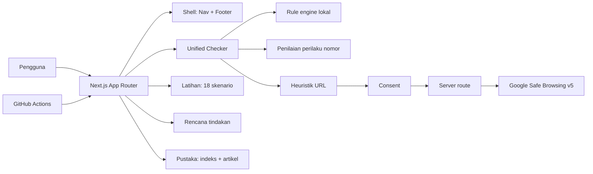

# Saring. Pendamping Kepercayaan Digital

> **Berhenti sebentar. Periksa sinyalnya.**
> Belum tentu penipuan. Belum tentu aman. Kenali tandanya sebelum bertindak.

Saring adalah aplikasi web yang membantu anak muda Indonesia mengenali pesan
penipuan daring, memeriksa sinyal URL dengan opsi reputasi Google Safe Browsing setelah
consent, menormalisasi nomor, berlatih mengambil keputusan yang lebih aman, dan
memahami langkah selanjutnya. tanpa akun dan tanpa layanan AI eksternal.


---

## Daftar isi

1. [Masalah dan tujuan](#masalah-dan-tujuan)
2. [Target pengguna](#target-pengguna)
3. [Fitur](#fitur)
4. [Tumpukan teknologi](#tumpukan-teknologi)
5. [Arsitektur](#arsitektur)
6. [Sistem deteksi heuristik](#sistem-deteksi-heuristik)
7. [Privasi dan penanganan data](#privasi-dan-penanganan-data)
8. [Menjalankan secara lokal](#menjalankan-secara-lokal)
9. [Perintah kualitas](#perintah-kualitas)
10. [Deployment](#deployment)
11. [Keterbatasan yang diketahui](#keterbatasan-yang-diketahui)
12. [Atribusi dan lisensi](#atribusi-dan-lisensi)
13. [Tautan](#tautan)

---

## Masalah dan tujuan

Penipuan digital semakin mahir memanfaatkan rasa takut, desakan, janji
berlebihan, dan peniruan pihak resmi. Korban sering kali bertindak sebelum
sempat memeriksa. Saring lahir dari premis sederhana: **keputusan menjadi lebih
aman ketika orang berhenti sejenak dan memeriksa sinyalnya.**

Aplikasi ini adalah **alat bantu pengambilan keputusan**, bukan hakim yang
memutuskan bersalah-tidaknya sebuah pesan. Hasilnya transparan, dapat
dijelaskan, dan disertai langkah lanjutan yang praktis.

## Target pengguna

- Pelajar dan mahasiswa Indonesia.
- Pencari kerja muda (lowongan palsu, biaya rekrutmen).
- Pengguna layanan digital sehari-hari (bank, e-wallet, marketplace).
- Siapa pun yang ingin lebih teliti sebelum membalas pesan mencurigakan.

## Fitur

### 1. Periksa. triase ancaman digital yang dapat dijelaskan

Fitur utama. Pengguna menempelkan pesan, lalu mesin aturan heuristik
menjelaskan sinyal bahaya yang ditemukan, lengkap dengan kategori, tingkat
keparahan, bukti teks, dan langkah selanjutnya.

Hasil dikelompokkan menjadi tiga (tidak pernah "aman"):

- **Banyak sinyal bahaya**
- **Perlu diperiksa lebih lanjut**
- **Sinyal yang ditemukan masih terbatas**

### 2. Latihan: simulasi keputusan dengan skor yang jelas

Bank berisi **18 skenario** yang mencakup permintaan pinjaman dari nomor baru,
permintaan OTP, ancaman pemblokiran akun, lowongan berbiaya, tugas online,
transaksi di luar aplikasi, paket kurir, investasi, giveaway, tautan login,
pemulihan akun, permintaan data pribadi, invoice, QRIS, layanan pelanggan, dan
percakapan normal yang memang tidak mencurigakan.

Tiga mode sesi: **5 soal**, **10 soal**, dan **seluruh bank**. Soal dipilih acak
tanpa duplikasi dalam satu sesi, dengan pengacak deterministik agar pengujian
dapat direproduksi.

Setiap pilihan bernilai **100** (langkah terbaik), **50** (cukup hati-hati tetapi
masih ada celah), atau **0** (berisiko). Nilai ini dijelaskan sebelum sesi
dimulai. Setelah setiap jawaban, pengguna melihat risiko dari pilihannya,
langkah yang seharusnya, dan alasan mengapa langkah itu lebih baik. Ringkasan
akhir menampilkan poin, persentase, jumlah keputusan terbaik, skor per kategori,
soal yang perlu dipelajari ulang, dan tautan ke artikel Pustaka yang relevan.

Skor hanya menggambarkan sesi latihan tersebut, bukan ukuran kemampuan keamanan
digital di dunia nyata.

### 3. Langkah: rencana tindakan kontekstual

Enam kondisi yang bisa dipilih: baru menerima pesan, terlanjur membuka tautan,
sudah memasukkan kata sandi atau OTP, sudah mentransfer uang, akun mungkin
diambil alih, dan sudah membagikan dokumen pribadi.

Setiap kondisi menghasilkan rencana lima bagian: **lakukan sekarang**, **setelah
itu**, **bukti yang perlu disimpan**, **yang perlu diperiksa**, dan **sumber
bantuan resmi**. Halaman ini juga bisa dibuka langsung dari hasil pemeriksaan
lewat `/langkah?kondisi=...`, sehingga pengguna tidak perlu mencari panduan
secara manual.

### 4. Pustaka: 14 artikel dengan halaman baca sendiri

Indeks `/pustaka` menampilkan grid tiga kolom di desktop, dua di tablet, satu di
mobile, lengkap dengan pencarian dan filter kategori. Setiap kartu menampilkan
kategori, judul, ringkasan, dan estimasi waktu baca yang dihitung dari panjang
teks sebenarnya.

Klik kartu membuka halaman artikel tersendiri di `/pustaka/[slug]`, bukan
memperluas isi di tempat. Setiap artikel memuat breadcrumb, dek, waktu baca,
daftar isi, isi berjudul, contoh kasus, langkah praktis, daftar periksa, sumber
rujukan resmi, dan artikel terkait.

## Tumpukan teknologi

- **Next.js 16** (App Router, dijalankan sebagai server Node.js)
- **React 19** dan **TypeScript** (mode `strict`)
- **Tailwind CSS 4**
- **Lucide React** untuk ikon
- **Vitest** + **React Testing Library** untuk pengujian unit/komponen
- **Playwright** untuk pengujian end-to-end
- **ESLint** dan `tsc --noEmit` untuk kualitas kode
- **GitHub Actions** untuk CI
- **Heroku** (Node.js buildpack) untuk deployment

## Arsitektur



Pesan, nomor, dan struktur URL dianalisis lokal. Hanya URL yang dikirim ke
Google Safe Browsing, dan hanya setelah persetujuan eksplisit.

```text
app/                     rute dan titik masuk aplikasi (App Router)
  pustaka/page.tsx       indeks Pustaka (grid + pencarian + filter)
  pustaka/[slug]/page.tsx  halaman artikel (generateStaticParams)
  langkah/page.tsx       rencana tindakan, menerima ?kondisi=
components/              komponen UI bersama dan khusus fitur
  periksa/               checker, hasil pesan, nomor, tautan
  pustaka/library.tsx    grid artikel
  latihan/simulator.tsx  sesi latihan + ringkasan skor
  langkah/guide.tsx      rencana tindakan lima bagian
lib/analysis/            mesin aturan, tipe, nomor, tautan (logika murni)
lib/reputation/          adapter Google Safe Browsing + decoder protobuf
data/                    artikel, skenario, panduan, contoh pesan
tests/                   unit, komponen, dan e2e
docs/                    dokumentasi teknis
```

Logika domain (`lib/analysis`) sepenuhnya **murni dan deterministik**. tidak
ada pemanggilan jaringan. sehingga dapat diuji tanpa peramban. Komponen UI
hanya memanggil fungsi tersebut dan menampilkan hasilnya.

Lihat [docs/ARCHITECTURE.md](docs/ARCHITECTURE.md) untuk penjelasan lebih rinci.

## Sistem deteksi heuristik

Mesin aturan menilai pesan berdasarkan tujuh kategori sinyal:

1. **Pencurian kredensial**. permintaan OTP, PIN, kata sandi, atau kode verifikasi.
2. **Desakan & intimidasi**. ancaman pemblokiran akun atau tenggat sempit.
3. **Permintaan pembayaran di muka**. biaya rekrutmen/administrasi/klaim.
4. **Janji tidak realistis**. untung pasti, tanpa risiko, iming-iming hadiah.
5. **Tautan mencurigakan**. penyingkat URL, alamat IP mentah, atau `http://`.
6. **Indikasi peniruan pihak resmi**. klaim otoritas atau domain mirip resmi.
7. **Instruksi percakapan berisiko**. pindah kanal atau melewati verifikasi.

Setiap aturan memiliki bobot (tinggi/sedang/rendah = 40/25/15). Skor sinyal
dijumlahkan (maksimum 100) dan dipetakan ke klasifikasi.

Ketentuan penting:

- Aturan **memperhatikan konteks**. Menyebut kata "OTP" dalam konteks edukasi
  (mis. *"jangan pernah bagikan OTP"*) tidak ditandai sebagai permintaan
  kredensial; dibutuhkan kata kerja permintaan di dekatnya.
- Tidak semua domain asing, ejaan tidak lazim, URL `http`, atau pesan asing
  otomatis dicap penipuan.
- **Skor bukan peluang penipuan.** Angka ini hanyalah total bobot indikator
  yang dikenali oleh aturan heuristik. bukan probabilitas statistik.

Setiap temuan menampilkan judul, penjelasan, kategori, tingkat keparahan, bukti
teks (bila ada), dan langkah praktis berikutnya. Hasil selalu menyertakan
pengingat:

> Tidak ditemukannya sinyal bahaya bukan berarti pesan ini aman. Analisis ini
> menggunakan aturan heuristik dan dapat melewatkan pola penipuan maupun
> menandai pesan yang sebenarnya sah.

## Pustaka, Latihan, dan Rencana Tindakan

- **Pustaka**: 14 artikel di `data/resources.ts`, masing-masing dengan kategori,
  ringkasan, 4 sampai 6 bagian berjudul, daftar periksa, sumber resmi, dan
  tautan artikel terkait. Waktu baca dihitung dari jumlah kata sebenarnya
  (`readingMinutes`), bukan angka tetap.
- **Latihan**: 18 skenario di `data/scenarios.ts`. Setiap pilihan punya nilai
  poin eksplisit (100/50/0), risiko, langkah yang seharusnya, dan alasannya.
  `pickSessionScenarios` memilih soal tanpa duplikasi memakai pengacak
  deterministik (`createRandom`), sehingga urutan dapat direproduksi pada
  pengujian. `scoreSession` menghitung poin, persentase, jumlah keputusan
  terbaik, skor per kategori, dan daftar soal yang perlu dipelajari ulang.
- **Rencana tindakan**: `data/guides.ts` menyimpan enam kondisi, masing-masing
  dengan langkah berprioritas (`segera`, `penting`, `lanjutan`), daftar bukti,
  daftar hal yang perlu diperiksa (`checks`), dan sumber bantuan resmi.
  Halaman `/langkah` menerima `?kondisi=` sehingga hasil pemeriksaan bisa
  menautkan langsung ke kondisi yang relevan.

Semua state latihan dan pilihan kondisi hanya berada di memori peramban. Tidak
ada yang dikirim ke server.

## Privasi dan penanganan data

| Input | Pemrosesan | Dikirim keluar | Penyimpanan |
|---|---|---|---|
| Pesan | Browser | Tidak | Memori sementara |
| URL heuristik | Browser | Tidak | Memori sementara |
| URL reputasi | Route server setelah consent | Google Safe Browsing | Tidak disimpan aplikasi |
| Nomor | Browser | Tidak pada mode default | Memori sementara |


Privasi adalah persyaratan produk, bukan fitur tambahan:

- Analisis pesan berjalan **sepenuhnya di peramban** melalui aturan deterministik lokal.
- Pesan yang ditempelkan **tidak pernah** dikirim ke server, penyedia AI, layanan
  analitik, log, atau pihak ketiga.
- Isi pesan **tidak disimpan** di `localStorage`, `sessionStorage`, cookie, database,
  atau log.
- Tidak ada pelacakan/analitik secara bawaan.
- Tidak diperlukan akun, email, nomor telepon, atau data pribadi.

Lihat [docs/SECURITY-AND-PRIVACY.md](docs/SECURITY-AND-PRIVACY.md) untuk detail,
termasuk kebijakan header keamanan dan variabel lingkungan.

## Menjalankan secara lokal

Prasyarat: **Node.js 22** dan **npm**.

```bash
npm install
npm run dev
```

Buka http://localhost:3000.

> Catatan: pada mode pengembangan (`next dev`), header CSP tidak aktif karena
> runtime pengembangan membutuhkan `eval`/inline script. CSP aktif pada build
> produksi (`next start`).

## Perintah kualitas

```bash
npm run lint        # ESLint
npm run typecheck   # tsc --noEmit
npm run test        # Vitest (unit + komponen)
npm run test:e2e    # Playwright (membangun & mengetes server produksi)
npm run build       # produksi build (next build)
```

## Deployment

Target deployment adalah **Heroku** (Node.js buildpack resmi), bukan static
export. Aplikasi dijalankan sebagai server Node.js.

Ringkasan langkah (lihat selengkapnya di [docs/DEPLOYMENT.md](docs/DEPLOYMENT.md)):

1. Pastikan akun Heroku memiliki CLI (`heroku login`).
2. `heroku create saring-app` (nama disesuaikan).
3. `git push heroku main`. Heroku mendeteksi `heroku/nodejs`, menjalankan
   `npm ci` (lockfile `package-lock.json`) lalu `npm run build`.
4. `web: npm start` (terbaca dari `Procfile`) menyajikan `next start` yang
   menyesuaikan `PORT` dari Heroku.

- `engines.node` sudah dipatok ke `22.x`.
- Paket dikunci dengan `package-lock.json` (npm).
- Tidak ada database atau add-on yang diperlukan.

Hubungkan domain kustom (jika tersedia): tambahkan domain di Heroku lalu
arahkan DNS mengikuti **target yang diberikan Heroku** untuk aplikasi tersebut
(jangan menebak nilai DNS. lihat `heroku domains` / `heroku domains:add`).

## Keterbatasan yang diketahui

- Mesin pesan berbasis **aturan heuristik**, bukan detektor penipuan
  menyeluruh. Ia dapat melewatkan pola baru atau menandai pesan sah.
- Pemeriksaan tautan memakai heuristik lokal dan dapat mengirim URL ke Google
  Safe Browsing hanya setelah consent. `no-match` bukan bukti aman, dan
  kegagalan provider tidak menghapus hasil lokal.
- Nomor telepon **tidak** memiliki provider reputasi. Penilaian nomor disusun
  dari perilaku pengirim yang dilaporkan pengguna.
- Artikel Pustaka bersifat edukatif dan tidak menggantikan penanganan resmi.
- Skor Latihan hanya menggambarkan sesi tersebut, bukan kemampuan dunia nyata.
- Hasil adalah **dukungan keputusan**, bukan bukti kesalahan atau jaminan aman.

## Atribusi dan lisensi

- Ikon oleh [Lucide](https://lucide.dev/) (ISC License).
- Konten edukasi dan contoh pesan bersifat **fiktif**; organisasi dan URL contoh
  tidak merujuk entitas nyata.
- Sumber pelaporan resmi: OJK (`iasc.ojk.go.id`, `kontak157.ojk.go.id`,
  `ojk.go.id`).

## Tautan

- **Demo langsung:** `<!--LIVE_URL-->`
- **Video demonstrasi:** `<!--DEMO_VIDEO_URL-->`
- **Repositori publik:** `<!--REPO_URL-->`

> Penanda di atas sengaja dikosongkan dan akan diisi setelah deployment serta
> video demonstrasi benar-benar tersedia.