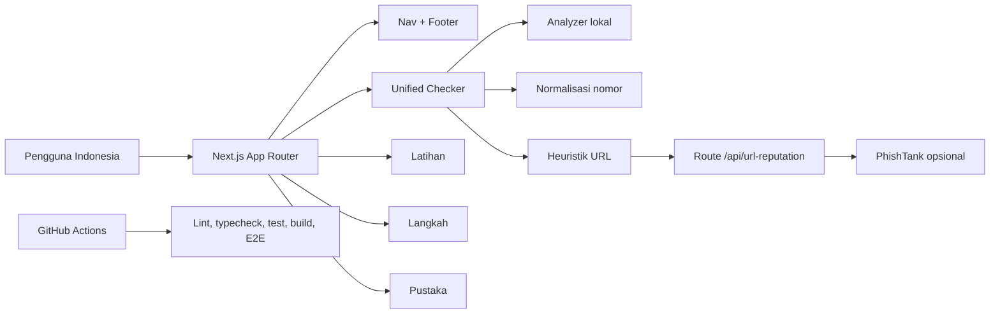

# Arsitektur

> **Status:** diagram di bawah menggambarkan implementasi saat ini. PhishTank adalah provider URL opsional melalui route server; tidak ada provider reputasi nomor aktif.

## Gambaran umum



Diagram ini memisahkan analisis pesan/struktur URL yang lokal dari pemeriksaan reputasi URL yang hanya dilakukan setelah consent melalui route server. Implementasi: `components/periksa/*`, `lib/analysis/*`, `app/api/url-reputation/route.ts`, dan `lib/reputation/phishtank.ts`.

## Gambaran umum

Saring menggunakan **Next.js 16 App Router** dengan pemisahan yang jelas antara
UI, logika domain, konten, validasi, dan pengujian. Tidak ada database, backend
terpisah, autentikasi, atau layanan AI eksternal.

```
app/               rute & titik masuk
  layout.tsx       kerangka global (Nav + Footer), metadata, lang="id"
  page.tsx         beranda (hero + analyzer + fitur + prinsip)
  periksa/page.tsx   fitur Periksa
  latihan/page.tsx   fitur Latihan
  langkah/page.tsx   fitur Langkah
  pustaka/page.tsx   fitur Pustaka
  not-found.tsx      halaman 404

components/
  nav.tsx           navigasi responsif (client)
  footer.tsx        footer (server)
  periksa/analyzer.tsx     formulir input + status (client)
  periksa/result-view.tsx  tampilan hasil (presentational)
  latihan/simulator.tsx    simulator keputusan (client)
  langkah/guide.tsx        panduan tindakan (client)
  pustaka/library.tsx      pustaka + pencarian (client)

lib/analysis/       logika domain MURNI (tanpa React, tanpa jaringan)
  types.ts          tipe & label (Severity, Finding, AnalysisResult, …)
  url.ts            deteksi & inspeksi URL sebagai string
  engine.ts         mesin aturan heuristik + klasifikasi
  index.ts          barrel export

data/               konten fiktif & edukasi yang ditinjau
  examples.ts       6 contoh pesan fiktif
  scenarios.ts      8 skenario latihan
  guides.ts         6 panduan tindakan + sumber OJK
  resources.ts      7 artikel pustaka

tests/              unit (tests/unit), komponen (tests/components), e2e (tests/e2e)
docs/               dokumentasi
```

## Mesin aturan (`lib/analysis`)

Inti produk adalah fungsi murni dan deterministik:

- `analyzeText(text): AnalysisResult` — validasi input, jalankan 7 kategori
  aturan, kumpulkan temuan, hitung skor, dan pilih klasifikasi.
- `extractUrls(text): DetectedUrl[]` — menemukan URL tanpa pernah mengaksesnya.

Setiap aturan mengembalikan satu atau beberapa `Finding` berisi: `category`,
`severity`, `title`, `explanation`, `evidence`, dan `nextStep`.

### Kategori aturan

| Kategori | Contoh sinyal | Bobot tertinggi |
| --- | --- | --- |
| credential-theft | permintaan OTP/PIN/kata sandi | tinggi |
| urgency-intimidation | ancaman blokir akun, tenggat sempit | tinggi |
| upfront-payment | biaya rekrutmen/administrasi/klaim | tinggi |
| unrealistic-promise | untung pasti, tanpa risiko, klaim hadiah | tinggi |
| suspicious-link | penyingkat URL, alamat IP, `http://` | sedang |
| impersonation | klaim otoritas, domain mirip resmi | sedang |
| risky-instruction | pindah kanal, lewati escrow/verifikasi | tinggi |

### Konteks & pengurangan positif palsu

Beberapa aturan dilengkapi penjaga konteks (`jangan`, `jangan pernah`,
`hindari`, …) agar pernyataan edukatif yang menyebut kata kunci tidak ditandai
sebagai permintaan. Aturan kredensial juga mensyaratkan **kata kerja
permintaan** di dekat kata kunci.

### Skor & klasifikasi

Bobot per keparahan: tinggi = 40, sedang = 25, rendah = 15. Skor = jumlah bobot
temuan (dibatasi 100), lalu dipetakan:

- ≥ 60 → `many-signals` ("Banyak sinyal bahaya")
- ≥ 25 → `needs-review` ("Perlu diperiksa lebih lanjut")
- < 25 → `limited-signals` ("Sinyal yang ditemukan masih terbatas")

Skor bukan probabilitas penipuan — hanya total bobot indikator.

## Komponen UI

Komponen feature adalah *client components* (`"use client"`) yang memakai state
lokal sederhana. `lib/analysis` diimpor sebagai modul murni; tidak ada
pemanggilan jaringan di sisi klien. Halaman dan footer adalah server components.

## Pemeriksaan URL yang aman

`extractUrls` hanya mengekstrak dan menginspeksi URL sebagai string (host,
skema, penyingkat, alamat IP). Ia **tidak** melakukan fetch, redirect, atau
unduhan. Temuan tautan hanya didasarkan pada indikator tekstual.