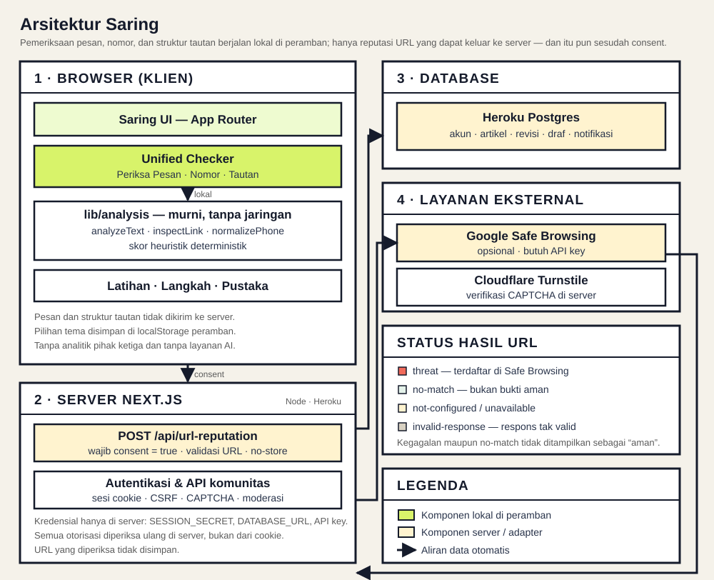

# Arsitektur

> **Status:** seluruh isi dokumen ini menggambarkan implementasi yang ada di repositori. **Google Safe Browsing v5** adalah provider reputasi URL melalui route server. Tidak ada provider reputasi nomor yang aktif.



Sumber diagram: [`assets/diagrams/system-overview.svg`](assets/diagrams/system-overview.svg).

Ringkasnya: **Checker** dan **`lib/analysis`** dieksekusi di peramban tanpa jaringan. Server Next.js hanya menangani `POST /api/url-reputation` (consent + validasi) yang memanggil adapter **Google Safe Browsing v5**. Sumber lain (AduanNomor, OJK) adalah *handoff* manual: pengguna menyalin data dan membuka situsnya sendiri.

## Gambaran umum

Saring menggunakan **Next.js 16 App Router** dengan pemisahan yang jelas antara
UI, logika domain, konten, validasi, dan pengujian.

Fitur pemeriksaan (Periksa) tetap berjalan di peramban tanpa database. Sejak
fitur akun, Komunitas, dan Pustaka kontribusi ditambahkan, aplikasi juga memiliki:

- **PostgreSQL** sebagai database utama (driver `pg`, tanpa ORM), diakses melalui
  abstraksi `Store` di `lib/db/` dengan dua implementasi: `postgres.ts` (produksi)
  dan `memory.ts` (development/pengujian).
- **Autentikasi** berbasis cookie terenkripsi `iron-session` + hash bcrypt, dengan
  role `user`/`admin` yang selalu diverifikasi ulang di server.
- **Migration terlacak** di `lib/db/migrations/` yang dijalankan release phase
  Heroku. `0002_submission_rich_body.sql` menambahkan kolom `body_json` (JSONB)
  untuk dokumen artikel kaya; kolom `body` tetap menyimpan proyeksi teks biasa
  sehingga artikel lama tidak berubah.
- **Cloudflare Turnstile** untuk form berisiko, diverifikasi server-side.
- **Tiptap** untuk editor artikel; kontennya divalidasi terhadap allowlist lalu
  dirender menjadi elemen React (tanpa HTML mentah).

Tidak ada backend terpisah, layanan AI eksternal, atau database kedua.

```
app/               rute & titik masuk
  layout.tsx       kerangka global (Nav + Footer), metadata, lang="id"
  page.tsx         beranda (hero + analyzer + fitur + prinsip)
  periksa/page.tsx   fitur Periksa
  latihan/page.tsx   fitur Latihan
  langkah/page.tsx   fitur Langkah
  pustaka/page.tsx   fitur Pustaka
  not-found.tsx      halaman 404

components/
  nav.tsx           sidebar desktop + drawer mobile (client)
  footer.tsx        footer (server)
  periksa/checker.tsx      segmented control 3 mode (client)
  periksa/analyzer.tsx     mode pesan: input + status (client)
  periksa/result-view.tsx  laporan hasil pesan (presentational)
  periksa/phone-check.tsx  mode nomor: input + normalisasi (client)
  periksa/phone-result.tsx tampilan hasil nomor (presentational)
  periksa/link-check.tsx   mode tautan: heuristik + consent (client)
  latihan/simulator.tsx    simulator keputusan (client)
  langkah/guide.tsx        panduan tindakan (client)
  pustaka/library.tsx      pustaka + pencarian (client)

app/api/url-reputation/route.ts   route server: consent + validasi + adapter

lib/analysis/       logika domain MURNI (tanpa React, tanpa jaringan)
  types.ts          tipe & label (Severity, Finding, AnalysisResult, …)
  url.ts            ekstraksi & inspeksi URL sebagai string
  link.ts           inspeksi tautan mendalam (userinfo, TLD, subdomain)
  phone.ts          normalisasi nomor Indonesia → domestik & E.164
  phoneReputation.ts status hasil nomor + jalur tanpa provider
  engine.ts         mesin aturan heuristik + klasifikasi
  index.ts          barrel export

lib/reputation/
  googleSafeBrowsing.ts  adapter server GSB v5: status, cache, atribusi
  protobuf.ts            decoder wire format untuk respons x-protobuf
  phishtank.ts           LEGACY, tidak dipakai runtime

data/               konten fiktif & edukasi yang ditinjau
  examples.ts       9 contoh pesan fiktif
  scenarios.ts      20 skenario latihan
  guides.ts         6 panduan tindakan + sumber OJK
  resources.ts      14 artikel pustaka
  sources.ts        kanal resmi AduanNomor (Komdigi)

tests/              unit (tests/unit), komponen (tests/components), e2e (tests/e2e)
docs/               dokumentasi
```

## Mesin aturan (`lib/analysis`)

Inti produk adalah fungsi murni dan deterministik:

- `analyzeText(text): AnalysisResult`. validasi input, jalankan 10 kategori
  aturan, kumpulkan temuan, hitung skor, dan pilih klasifikasi.
- `extractUrls(text): DetectedUrl[]`. menemukan URL tanpa pernah mengaksesnya.

Setiap aturan mengembalikan satu atau beberapa `Finding` berisi: `category`,
`severity`, `title`, `explanation`, `evidence`, dan `nextStep`.

### Kategori aturan

| Kategori | Contoh sinyal | Bobot tertinggi |
| --- | --- | --- |
| credential-theft | permintaan OTP/PIN/kata sandi | tinggi |
| urgency-intimidation | ancaman blokir akun, tenggat sempit | tinggi |
| upfront-payment | biaya rekrutmen/administrasi/klaim | tinggi |
| unrealistic-promise | untung pasti, tanpa risiko, klaim hadiah | tinggi |
| suspicious-link | penyingkat URL, alamat IP, `http://`, domain mirip resmi | tinggi bila menyertai permintaan kredensial/uang/ancaman |
| impersonation | klaim otoritas, domain mirip resmi | sedang |
| risky-instruction | pindah kanal, lewati escrow/verifikasi | tinggi |
| acquaintance-impersonation | klaim nomor baru + permintaan uang | tinggi |
| money-request | permintaan pinjaman/transfer | sedang |
| verification-blocking | alasan tidak bisa ditelepon/diverifikasi | tinggi |

### Konteks & pengurangan positif palsu

Sejak audit mesin, aturan dinilai **per klausa** (`lib/analysis/context.ts`),
bukan per jendela ±60 karakter:

- Penanda protektif (`jangan`, `hindari`, `waspada`, `tidak akan pernah meminta`)
  hanya menetralkan klausa tempat ia muncul. "Jangan bagikan OTP. Tapi kirim kode
  OTP kamu" tetap terdeteksi.
- Kalimat edukasi/berita ("pelaku biasanya bilang…", "contoh modus", "artikel")
  dan narasi lampau ("kemarin saya kirim kode OTP") tidak diperlakukan sebagai
  permintaan.
- Permintaan harus memuat kata kerja permintaan pada klausa yang sama; bentuk
  deskriptif seperti "aplikasi ini meminta kode OTP" tidak ditandai.
- Severity mengikuti kombinasi sinyal, bukan satu kata: ancaman akun tunggal
  bernilai sedang, tautan mencurigakan naik ke tinggi bila menyertai permintaan
  kredensial/uang/ancaman, dan klaim hadiah tanpa permintaan turun ke rendah.

### Skor & klasifikasi

Bobot per keparahan: tinggi = 40, sedang = 25, rendah = 15. Skor = jumlah bobot
temuan (dibatasi 100), lalu dipetakan:

- ≥ 70 → `many-signals` ("Banyak sinyal bahaya")
- ≥ 35 → `needs-review` ("Perlu diperiksa lebih lanjut")
- < 35 → `limited-signals` ("Sinyal yang ditemukan masih terbatas")

Skor bukan probabilitas penipuan. hanya total bobot indikator.

## Komponen UI

Komponen feature adalah *client components* (`"use client"`) dengan state lokal
sederhana. `lib/analysis` adalah modul murni yang di-bundle ke klien.

Satu-satunya pemanggilan jaringan dari klien adalah `POST /api/url-reputation`
di `link-check.tsx`, dan hanya ketika pengguna mencentang consent. Mode pesan
dan mode nomor tidak pernah memanggil jaringan.

## Pustaka: indeks dan halaman artikel

- `app/pustaka/page.tsx` memuat header lalu `<Library />`.
- `components/pustaka/library.tsx` adalah client component: pencarian teks,
  filter kategori, dan grid responsif (1 kolom mobile, 2 tablet, 3 desktop).
  Kartu pertama ditampilkan lebih besar saat filter berada di keadaan awal.
- `app/pustaka/[slug]/page.tsx` adalah server component dengan
  `generateStaticParams` (14 halaman diprerender saat build),
  `generateMetadata`, dan `notFound()` untuk slug tidak dikenal.
  `params` dibaca sebagai Promise sesuai Next.js 16.
- Konten berada di `data/resources.ts`. Tipe `ResourceArticle` memisahkan data
  dari tampilan. `readingMinutes` menghitung estimasi dari jumlah kata nyata.

## Latihan: bank skenario dan penilaian

- `data/scenarios.ts` memuat `SCENARIOS` (20 objek), `SESSION_MODES`
  (5/10/semua), `createRandom` (mulberry32), `pickSessionScenarios`, dan
  `scoreSession`.
- `components/latihan/simulator.tsx` mengelola fase `intro`, `question`, dan
  `summary` dengan state lokal. Tidak ada persistensi.
- Seed diturunkan dari mode sesi sehingga E2E dapat diandalkan.

## Pusat Bantuan & Pelaporan

- `data/guides.ts` memuat enam kondisi. Setiap kondisi punya `steps`
  (prioritas), `evidenceChecklist`, `checks`, dan `resources`.
- `OFFICIAL_RESOURCES` memuat kanal resmi: AduanNomor (Komdigi), AduanKonten,
  CekRekening, IASC (OJK), Kontak 157 OJK, dan OJK. Semuanya tautan manual;
  tidak ada integrasi API dan pengguna membuka sendiri di situs lembaga.
- `app/langkah/page.tsx` membaca `searchParams` (Promise di Next.js 16) dan
  meneruskan `initialSituation` ke `<Guide />`.
- `components/langkah/guide.tsx` menampilkan lima bagian berurutan. Checklist
  bukti adalah checkbox lokal (`useState`) yang tidak disimpan ke storage,
  server, atau layanan eksternal.
- `components/periksa/result-view.tsx` memilih tautan kondisi berdasarkan sinyal
  yang benar-benar ditemukan: tautan → `clicked-link`, kredensial →
  `entered-credentials`, permintaan uang → pilihan `received-message` atau
  `transferred-money`, selain itu `received-message`. Deteksi sinyal tidak
  dianggap sebagai bukti pengguna sudah menjadi korban.

## Sinkronisasi status autentikasi

- `lib/auth/events.ts` menyediakan `AUTH_CHANGED_EVENT` dan
  `notifyAuthChanged()`, sebuah event browser internal.
- `components/auth/account-menu.tsx` memuat status dari `GET /api/auth/me` saat
  dipasang dan memuat ulang setiap kali event tersebut diterima, sehingga
  sidebar desktop dan drawer mobile ikut berubah tanpa reload.
- `components/auth/auth-form.tsx` memancarkan event setelah login/registrasi
  berhasil; logout memancarkan event setelah server mengonfirmasi.
- Role tetap berasal dari server; tidak ada role yang disimpan di localStorage
  dan tidak ada polling.

## Pemeriksaan URL yang aman

Tiga tingkat yang dipisahkan dengan jelas:

1. `extractUrls` / `inspectUrl` (`lib/analysis/url.ts`). ekstraksi tautan di
   dalam pesan, termasuk domain tanpa skema (`bca-verifikasi.xyz/login`) dan
   alamat IP. Parsing memakai `URL` sehingga port, userinfo, huruf besar, dan
   titik di akhir dinormalisasi. Domain dari alamat email tidak diambil, dan URL
   yang sama tidak dihitung dua kali.
2. `inspectLink` (`lib/analysis/link.ts`). inspeksi struktural: skema, userinfo,
   alamat IP, penyingkat, TLD tidak lazim, subdomain meniru merek. Mode pesan
   memakai inspeksi yang sama, sehingga temuan tautan di pesan dan di
   Periksa Tautan konsisten.
3. `lookupGoogleSafeBrowsing` (`lib/reputation/googleSafeBrowsing.ts`). reputasi eksternal,
   hanya lewat route server dan hanya setelah consent. Respons dibaca sebagai
   protobuf oleh `lib/reputation/protobuf.ts`.

Ketiganya **tidak pernah** membuka, mengikuti redirect, mengunduh, atau
menjalankan isi URL. Status eksternal dibedakan menjadi `threat`, `no-match`,
`not-configured`, `unauthorized`, `quota-exceeded` (HTTP 429), `timeout`,
`http-error`, dan `invalid-response`; `no-match` bukan bukti aman.