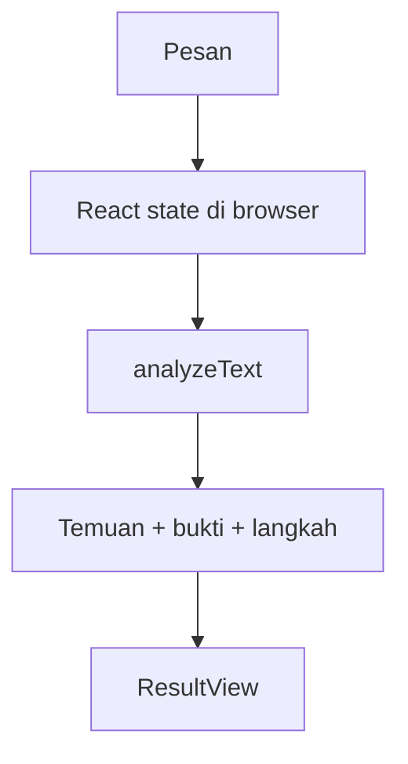
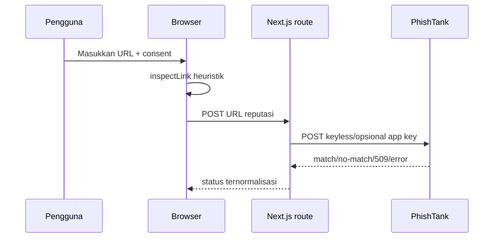
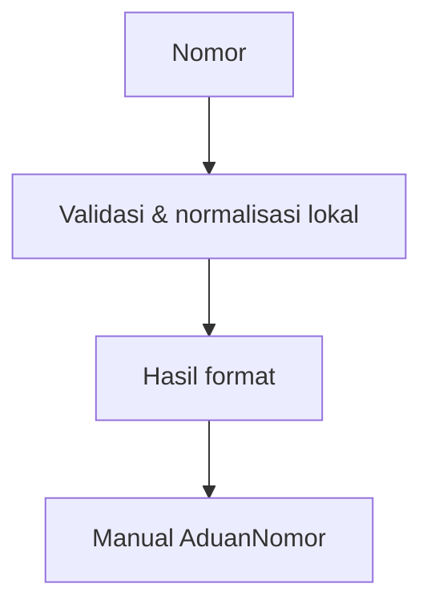

# Alur Data Saring

## Pesan

Pesan tidak dikirim atau disimpan.

## URL

URL dikirim hanya setelah consent. No-match bukan bukti aman; kegagalan bukan hasil bersih.

## Nomor

Belum ada provider reputasi nomor gratis dan berizin yang diaktifkan; aplikasi tidak mengarang hasil.
