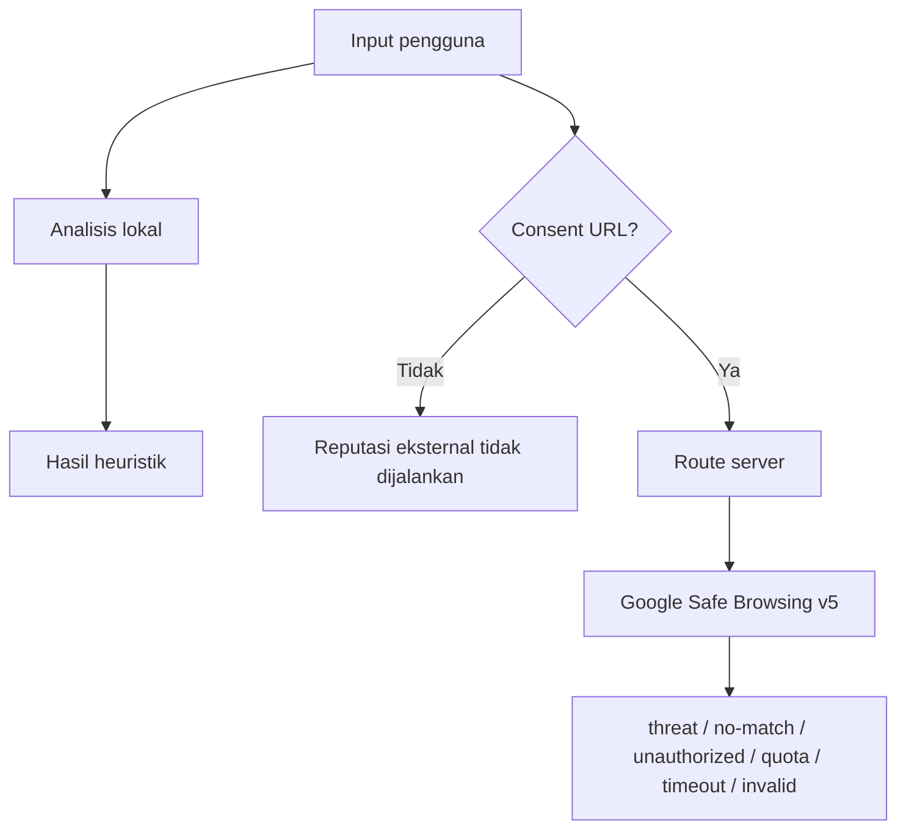

# Sumber Data dan Verifikasi

## Matriks status

| Sumber | Tujuan | Integrasi | Credential | Status aktual |
|---|---|---|---|---|
| Rule engine lokal | Sinyal bahasa pesan | Client-side | Tidak | Aktif dan diuji |
| Heuristik URL | Struktur hostname/URL | Client-side | Tidak | Aktif dan diuji |
| Google Safe Browsing v5 | Reputasi URL | Route server `POST /api/url-reputation` | `GOOGLE_SAFE_BROWSING_API_KEY` (server) | **Provider utama.** Live test 28/10/2026: HTTP 200, no-match dan threat terbaca |
| PhishTank | Catatan phishing komunitas | Tidak dipakai runtime | - | **Legacy.** Tanpa app key ditolak HTTP 403 |
| AduanNomor | Pemeriksaan nomor manual | Link eksternal | Tidak | Manual, bukan API |
| IASC/OJK | Pelaporan insiden | Link eksternal | Tidak | Rujukan manual |



No-match bukan bukti aman.

## Google Safe Browsing v5

Dokumentasi resmi: <https://developers.google.com/safe-browsing/reference/rest/v5/urls/search>

### Kontrak yang benar-benar dipakai

Verifikasi dokumentasi menemukan bahwa v5 **berbeda dari v4**:

- Metode **HTTP GET**, bukan POST.
- Endpoint: `https://safebrowsing.googleapis.com/v5/urls:search`
- Parameter query: `urls` (maksimal 50) dan `key`.
- **Request body harus kosong.** Skema v4 (`threatInfo`, `threatEntries`) tidak
  berlaku di v5.
- Tanpa kecocokan: **HTTP 200** dengan daftar `threats` kosong, bukan 404.

### Format respons: protobuf, bukan JSON

Ini temuan penting dari pengujian langsung. Endpoint membalas
`Content-Type: application/x-protobuf`. Parameter `alt=json` **ditolak** dengan
`Unsupported Output Format`. Karena itu Saring membaca wire format protobuf
sendiri di `lib/reputation/protobuf.ts` (tanpa dependency tambahan).

Skema yang dipakai:

```text
SearchUrlsResponse { repeated ThreatUrl threats = 1; Duration cacheDuration = 2; }
ThreatUrl          { string url = 1; repeated ThreatType threatTypes = 2; }
Duration           { int64 seconds = 1; int32 nanos = 2; }
```

Nilai enum `ThreatType` yang terverifikasi dari respons nyata:
`1 = MALWARE`, `2 = SOCIAL_ENGINEERING`. Nomor 3 dan 4 mengikuti enum resmi
(`UNWANTED_SOFTWARE`, `POTENTIALLY_HARMFUL_APPLICATION`).

Catatan: `url` yang dikembalikan Google berupa ekspresi host+path tanpa skema,
bukan selalu identik dengan string yang dikirim.

### Hasil live 28 Oktober 2026

Dijalankan dari route Saring dengan `GOOGLE_SAFE_BROWSING_API_KEY` aktif:

| Kasus | HTTP route | Status internal | Catatan |
|---|---|---|---|
| `https://example.com/` | 200 | `no-match` | Body protobuf 5 byte hanya berisi cacheDuration 300 detik |
| URL uji resmi Google `.../MALWARE/URL/` | 200 | `threat` | `threatTypes: ["MALWARE"]`, atribusi ditampilkan |
| Tanpa `consent: true` | 400 | ditolak | Tidak ada permintaan keluar |
| `ftp://` dan URL rusak | 400 | ditolak | Validasi sebelum lookup |

Permintaan kedua untuk URL yang sama mengembalikan `cacheHit: true` tanpa
memanggil Google lagi.

### Status yang dibedakan

`threat`, `no-match`, `not-configured`, `unauthorized` (400 `API_KEY_INVALID`,
401, 403), `quota-exceeded` (429), `timeout`, `http-error`, `invalid-response`.

Status selain `threat` dan `no-match` ditandai `inconclusive: true`, sehingga UI
tidak boleh menarik kesimpulan apa pun darinya.

### Cache

`cacheDuration` dari Google dipakai sebagai TTL (dibatasi 30 detik sampai 24
jam). Cache disimpan di memori proses, maksimal 500 entri. Ini mengurangi
pemakaian kuota dan sesuai instruksi dokumentasi bahwa klien harus menghormati
`cacheDuration`.

### Kuota dan biaya

Dokumentasi Google menyatakan Safe Browsing gratis untuk penggunaan
nonkomersial. Saring tidak mengaktifkan billing, tidak memakai free trial
berbayar, dan tidak menambahkan metode pembayaran. API key hanya dibaca di
server melalui `GOOGLE_SAFE_BROWSING_API_KEY`, tidak pernah dikirim ke klien.
Bila key tidak tersedia, statusnya `not-configured` dan inspeksi lokal tetap
berjalan.

### Atribusi

Bila ada kecocokan ancaman, UI menampilkan **"Advisory provided by Google"**
dengan tautan ke <https://developers.google.com/safe-browsing/> sesuai
ketentuan dokumentasi.

### Pengujian

- `tests/unit/googleSafeBrowsing.test.ts`: 18 kasus termasuk request shape,
  threat, no-match, body kosong, 400/403/429/500, timeout, gangguan jaringan,
  JSON rusak, skema salah, kebocoran key, dan cache.
- `tests/unit/gsbProtobuf.test.ts`: decoder diuji memakai **byte nyata** hasil
  panggilan live, sehingga pemetaan enum dan cacheDuration tervalidasi.

## PhishTank (legacy, tidak dipakai runtime)

Adapter masih ada di `lib/reputation/phishtank.ts` sebagai rujukan sejarah,
tetapi tidak diimpor oleh route maupun komponen. Alasan ditinggalkan: endpoint
`checkurl` menolak permintaan tanpa app key dengan HTTP 403, sehingga lookup
hampir selalu gagal bagi pengguna. Jangan menghidupkannya kembali tanpa
credential valid.

## AduanNomor. Komdigi

- URL resmi: https://aduannomor.id/
- Tujuan: portal manual Komdigi untuk memeriksa/mengadukan nomor.
- Integrasi programatik: tidak ada. Tidak ditemukan dokumentasi API publik yang dapat diverifikasi.
- Data yang dikirim Saring: tidak ada; pengguna membuka portal sendiri melalui tindakan eksplisit.
- Status: **opsional** sebagai pemeriksaan tambahan, bukan sumber hasil utama Saring.
- Perubahan perilaku: penilaian nomor kini dihasilkan **di dalam Saring**
  (`lib/analysis/phoneContext.ts`) berdasarkan perilaku pengirim yang dilaporkan
  pengguna. Portal resmi hanya tautan tambahan di dalam blok yang bisa dibuka.
- Limitasi: Saring tidak menyatakan nomor terlapor, bersih, atau aman.

## IASC. OJK

- URL resmi: https://iasc.ojk.go.id/
- Tujuan: rujukan pelaporan penipuan transaksi keuangan.
- Integrasi programatik: tidak ada; tautan dibuka manual.
- Status: sumber resmi yang ditampilkan pada panduan transfer.
- Limitasi: Saring tidak menjanjikan pemulihan dana.

## Pemeriksaan pesan dan tautan

Tidak memakai sumber eksternal. Pesan dianalisis lokal dengan rule engine deterministik. URL diperiksa sebagai string; Saring tidak melakukan fetch, redirect, atau lookup reputasi.
