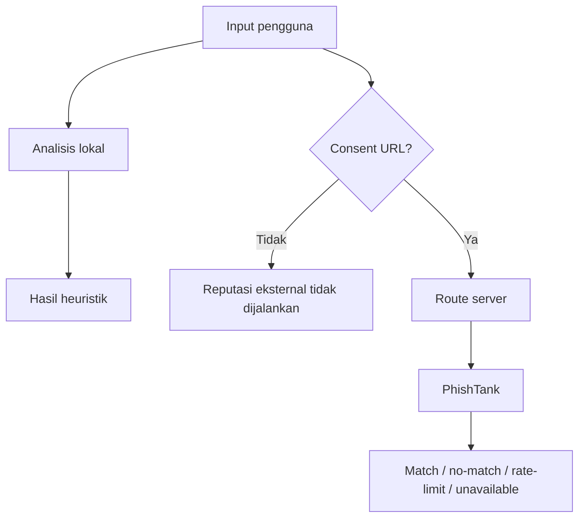

# Sumber Data dan Verifikasi

## Matriks status

| Sumber | Tujuan | Integrasi | Credential | Status aktual |
|---|---|---|---|---|
| Rule engine lokal | Sinyal bahasa pesan | Client-side | Tidak | Aktif dan diuji |
| Heuristik URL | Struktur hostname/URL | Client-side | Tidak | Aktif dan diuji |
| PhishTank | Catatan phishing komunitas | Route server `POST /api/url-reputation` | Opsional `PHISHTANK_APP_KEY` | Adapter aktif; **live test 28/10/2026: tanpa app key ditolak HTTP 403** |
| AduanNomor | Pemeriksaan nomor manual | Link eksternal | Tidak | Manual, bukan API |
| IASC/OJK | Pelaporan insiden | Link eksternal | Tidak | Rujukan manual |

No-match bukan bukti aman.

## PhishTank — hasil verifikasi live

Diuji langsung pada 28 Oktober 2026 terhadap endpoint
`https://checkurl.phishtank.com/checkurl/` **tanpa app key**:

- Hasil: **HTTP 403 (Forbidden)**, bukan 509 dan bukan timeout.
- Artinya: permintaan tanpa kredensial **ditolak**, sehingga pemeriksaan
  reputasi tidak dapat berjalan sama sekali tanpa `PHISHTANK_APP_KEY`.
- Konsekuensi desain: adapter memetakannya ke status `unauthorized`, menampilkan
  alasan yang sebenarnya (HTTP 403 + perlunya app key), dan **tidak** menyebut
  URL aman maupun tidak ditemukan.

Dokumentasi resmi menyebut app key opsional dengan batas lebih ketat. Pada
praktiknya (minimal saat pengujian ini) akses tanpa key ditolak, jadi jangan
mengandalkan lookup keyless untuk demo. Dengan app key, status yang mungkin
tetap dibedakan menjadi `match`, `no-match`, `rate-limited`, `unauthorized`,
`http-error`, `timeout`, dan `invalid-response`.

Status `invalid-response` dipakai ketika respons tidak memuat `results` atau
tidak memuat `in_database` yang jelas — kondisi ini **tidak** diperlakukan
sebagai `no-match`, karena itu akan salah dibaca sebagai “tidak ditemukan”.

Adapter diuji dengan mock deterministik di `tests/unit/phishtank.test.ts`
(13 kasus) sehingga CI tidak bergantung pada layanan eksternal.

## AduanNomor — Komdigi

- URL resmi: https://aduannomor.id/
- Tujuan: portal manual Komdigi untuk memeriksa/mengadukan nomor.
- Integrasi programatik: tidak ada. Tidak ditemukan dokumentasi API publik yang dapat diverifikasi.
- Data yang dikirim Saring: tidak ada; pengguna membuka portal sendiri melalui tindakan eksplisit.
- Status: **opsional** sebagai pemeriksaan tambahan, bukan sumber hasil utama Saring.
- Perubahan perilaku: penilaian nomor kini dihasilkan **di dalam Saring**
  (`lib/analysis/phoneContext.ts`) berdasarkan perilaku pengirim yang dilaporkan
  pengguna. Portal resmi hanya tautan tambahan di dalam blok yang bisa dibuka.
- Limitasi: Saring tidak menyatakan nomor terlapor, bersih, atau aman.

## IASC — OJK

- URL resmi: https://iasc.ojk.go.id/
- Tujuan: rujukan pelaporan penipuan transaksi keuangan.
- Integrasi programatik: tidak ada; tautan dibuka manual.
- Status: sumber resmi yang ditampilkan pada panduan transfer.
- Limitasi: Saring tidak menjanjikan pemulihan dana.

## Pemeriksaan pesan dan tautan

Tidak memakai sumber eksternal. Pesan dianalisis lokal dengan rule engine deterministik. URL diperiksa sebagai string; Saring tidak melakukan fetch, redirect, atau lookup reputasi.
