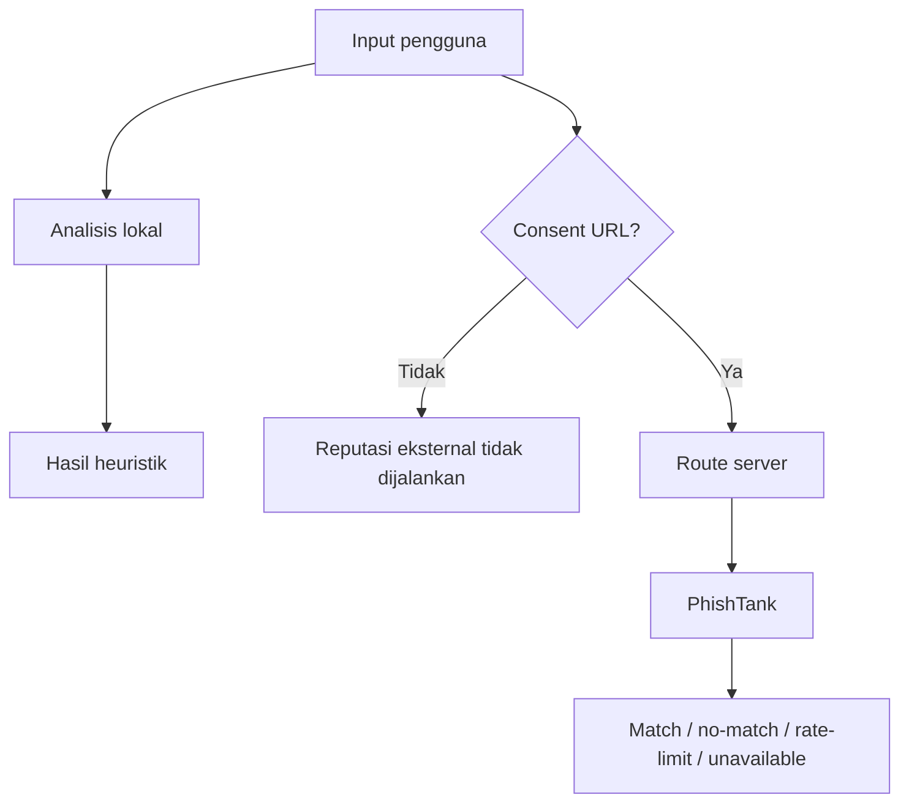

# Sumber Data dan Verifikasi

## Matriks status

| Sumber | Tujuan | Integrasi | Credential | Status aktual |
|---|---|---|---|---|
| Rule engine lokal | Sinyal bahasa pesan | Client-side | Tidak | Aktif dan diuji |
| Heuristik URL | Struktur hostname/URL | Client-side | Tidak | Aktif dan diuji |
| PhishTank | Catatan phishing komunitas | Route server `POST /api/url-reputation` | Opsional `PHISHTANK_APP_KEY` | Adapter aktif; live belum diverifikasi |
| AduanNomor | Pemeriksaan nomor manual | Link eksternal | Tidak | Manual, bukan API |
| IASC/OJK | Pelaporan insiden | Link eksternal | Tidak | Rujukan manual |

No-match bukan bukti aman. Adapter PhishTank diuji dengan mock deterministik; belum ada live smoke test tanpa credential.

## AduanNomor — Komdigi

- URL resmi: https://aduannomor.id/
- Tujuan: mengarahkan pengguna ke portal manual untuk pemeriksaan/pengaduan nomor.
- Integrasi programatik: tidak ada. Tidak ditemukan dokumentasi API publik yang dapat diverifikasi.
- Data yang dikirim Saring: tidak ada; pengguna membuka portal sendiri melalui tindakan eksplisit.
- Status: sumber resmi untuk rujukan manual, bukan provider API Saring.
- Limitasi: Saring hanya menormalisasi format nomor dan tidak menyatakan reputasi nomor.

## IASC — OJK

- URL resmi: https://iasc.ojk.go.id/
- Tujuan: rujukan pelaporan penipuan transaksi keuangan.
- Integrasi programatik: tidak ada; tautan dibuka manual.
- Status: sumber resmi yang ditampilkan pada panduan transfer.
- Limitasi: Saring tidak menjanjikan pemulihan dana.

## Pemeriksaan pesan dan tautan

Tidak memakai sumber eksternal. Pesan dianalisis lokal dengan rule engine deterministik. URL diperiksa sebagai string; Saring tidak melakukan fetch, redirect, atau lookup reputasi.
