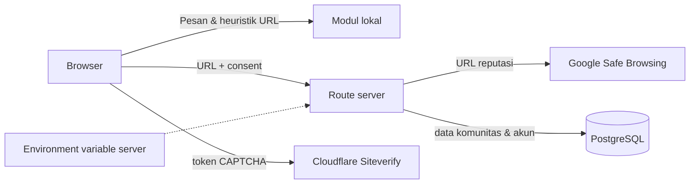

# Keamanan & Privasi

## Ringkasan pemrosesan

| Data | Lokasi proses | Dikirim eksternal | Persistensi |
|---|---|---|---|
| Pesan | Browser | Tidak | Memori React saja |
| URL heuristik | Browser | Tidak | Memori React saja |
| URL reputasi | Route server setelah consent | Google Safe Browsing | Cache singkat di memori proses |
| Nomor | Browser | Tidak | Memori React saja |
| Akun (email, nama tampilan, hash kata sandi) | Server | Tidak | PostgreSQL |
| Konten komunitas, pengajuan artikel, laporan | Server | Tidak | PostgreSQL |
| Token Turnstile | Server (Siteverify) | Cloudflare | Tidak disimpan |



## Prinsip privasi

Fitur utama (Periksa) berjalan sepenuhnya di peramban pengguna menggunakan
aturan deterministik lokal.

Apa yang **tidak** dilakukan:

- Isi pesan tidak dikirim ke server, penyedia AI, layanan analitik, log, atau pihak ketiga.
- URL hanya dikirim ke Google Safe Browsing setelah pengguna memberi consent eksplisit. Jangan memeriksa URL pribadi yang memuat token sesi.
- Isi pesan tidak disimpan di `localStorage`, `sessionStorage`, cookie, database, atau log.
- Tidak memasang pelacak/analitik secara bawaan.

Sejak langkah pertama, antarmuka analisis menampilkan pemberitahuan privasi dan
mengingatkan pengguna untuk **tidak** menempelkan kata sandi/OTP/PIN/data
pribadi yang sebenarnya.

## Data yang disimpan saat pengguna membuat akun

Akun hanya diperlukan untuk menulis di Komunitas atau mengajukan artikel.
Pemeriksaan pesan, nomor, dan tautan tetap dapat dipakai tanpa akun.

| Tabel | Isi | Tidak berisi |
|---|---|---|
| `users` | email, nama tampilan, hash kata sandi (bcrypt cost 12), role, waktu dibuat | kata sandi mentah, nomor telepon, identitas |
| `threads` / `replies` | judul, kategori, isi, penulis, status disembunyikan | data pribadi yang diminta aplikasi |
| `submissions` | **versi publik** artikel kontribusi (dokumen JSON tervalidasi) + status tinjauan + slug | versi draf yang tidak dikirim, HTML mentah |
| `submission_revisions` | usulan revisi artikel terbit + status tinjauan + catatan admin | konten publik aktif (berada di `submissions`) |
| `drafts` | draf artikel/pertanyaan (JSONB) milik satu akun | konten yang sudah diajukan |
| `article_bookmarks` | `user_id` + `article_slug` | salinan konten artikel |
| `notifications` | judul pesan, tautan internal, `read_at`, `dedupe_key` | isi draf privat, token, data sensitif |
| `reports` | alasan laporan, keterangan, status | identitas pelapor pada tampilan publik |
| `moderation_log` | aksi admin, target, catatan | isi pesan pemeriksaan |
| `rate_limits` | nama bucket + penghitung + awal jendela | isi konten, token, IP mentah |

Isi halaman Periksa **tidak pernah** ditulis ke tabel mana pun.

## Header keamanan

`next.config.ts` menetapkan header berikut pada semua respons:

- `X-Frame-Options: DENY`
- `X-Content-Type-Options: nosniff`
- `Referrer-Policy: strict-origin-when-cross-origin`
- `X-Permitted-Cross-Domain-Policies: none`
- `X-DNS-Prefetch-Control: off`
- `Permissions-Policy: camera=(), microphone=(), geolocation=(), payment=()`
- `Cross-Origin-Opener-Policy: same-origin`

Pada `NODE_ENV=production` ditambahkan:

- `Content-Security-Policy`: `default-src 'self'`, `script-src 'self' 'unsafe-inline' https://challenges.cloudflare.com`, `style-src 'self' 'unsafe-inline'`, `img-src 'self' data: blob:`, `font-src 'self' data:`, `connect-src 'self' https://challenges.cloudflare.com`, `frame-src https://challenges.cloudflare.com`, `frame-ancestors 'none'`, `base-uri 'self'`, `form-action 'self'`, `object-src 'none'`, `upgrade-insecure-requests`.
- `Strict-Transport-Security` **hanya** bila `SARING_ENABLE_HSTS=1` (setelah HTTPS stabil).

`unsafe-inline` pada `script-src` masih diperlukan karena Next.js menyisipkan
skrip inline untuk data halaman. CSP tidak diterapkan pada `next dev` karena
runtime pengembangan memerlukan `eval`.

Halaman privat dan seluruh `/api/*` mengirim `Cache-Control: private, no-store`.

## Autentikasi dan sesi

- Sesi memakai `iron-session`: cookie `saring_session` yang **terenkripsi dan
  ditandatangani**, `httpOnly`, `SameSite=Lax`, dan `Secure` pada production.
- `SESSION_SECRET` minimal 32 karakter. Tanpa itu, production menolak berjalan.
- Kata sandi di-hash dengan bcrypt cost 12. Tidak ada kata sandi mentah yang
  disimpan atau dicatat.
- Login memakai perbandingan hash tiruan saat email tidak ditemukan, sehingga
  waktu respons tidak membocorkan keberadaan akun. Pesan gagal login bersifat
  umum.
- Role **selalu** dibaca ulang dari database pada setiap request
  (`requireUser`/`requireAdmin`), bukan dari klaim di cookie. Menurunkan role
  langsung berlaku pada request berikutnya.
- Registrasi selalu membuat role `user`. Pengguna tidak dapat mengirim atau
  menaikkan role sendiri; hanya admin yang dapat mengubah role lewat
  `/api/admin/moderate`, dan admin tidak dapat mengubah role akunnya sendiri.

## Otorisasi per operasi

| Operasi | Pemeriksaan server |
|---|---|
| Membuat diskusi/balasan | `requireUser` + rate limit + CAPTCHA |
| Mengirim/mengubah artikel | `requireUser` + kepemilikan (`author_id`) + status bukan final + rate limit + CAPTCHA |
| Mengajukan revisi artikel terbit | `requireUser` + kepemilikan + `status = approved` + rate limit + CAPTCHA |
| Menyetujui/menolak revisi | `requireAdmin` + status revisi masih `pending`/`needs_revision` |
| Menyimpan/menghapus draf | `requireUser`; `owner_id` dari sesi, bukan body |
| Bookmark | `requireUser` + slug harus dapat diakses publik (bawaan atau `approved`) |
| Notifikasi | `requireUser`; semua query memakai `where user_id = sesi` |
| Melaporkan konten | `requireUser` + target harus ada + anti-duplikat + rate limit + CAPTCHA |
| Semua aksi admin | `requireAdmin` + rate limit + validasi skema |
| Melihat `/akun` | `getCurrentUser`, data difilter `author_id` |
| Melihat `/admin/*` | `getCurrentUser` + `role === "admin"` (404 untuk non-admin) |

Pemeriksaan kepemilikan (mencegah IDOR) dilakukan di kueri (`where id = $1 and
author_id = $2`), bukan hanya di UI.

### Revisi artikel publik (versioning)

- `submissions` **hanya** menyimpan versi publik yang terakhir disetujui.
- Mengajukan revisi membuat baris `submission_revisions` berstatus `pending`;
  konten publik tidak disentuh, sehingga pembaca tetap melihat versi lama.
- Menyetujui revisi menyalin isi revisi ke `submissions` **di dalam satu
  transaksi PostgreSQL** (`publishRevision`) dan mempertahankan `slug`, sehingga
  URL publik tidak berubah. Jika transaksi gagal, versi lama tetap utuh.
- Menolak atau meminta perbaikan **tidak** mengubah `submissions`.
- Indeks unik parsial `submission_revisions_one_pending_idx` mencegah dua revisi
  `pending` untuk artikel yang sama.
- Revisi tidak dapat diterbitkan dua kali (`status` diperiksa dengan `for
  update`), dan revisi untuk artikel yang tidak lagi `approved` ditolak.

## Konten artikel kaya (rich text)

Artikel kontribusi ditulis dengan editor Tiptap dan disimpan sebagai **dokumen
JSON terstruktur**, bukan HTML.

### Format penyimpanan

| Kolom | Isi | Keterangan |
|---|---|---|
| `submissions.body_json` (`jsonb`) | Dokumen Tiptap yang sudah dinormalisasi | Sumber utama format. `NULL` untuk artikel lama. |
| `submissions.body` (`text`) | Proyeksi teks biasa dari `body_json` | Diturunkan **di server**, dipakai untuk pratinjau, daftar, dan artikel lama. |

Migration: `lib/db/migrations/0002_submission_rich_body.sql` (aditif, idempoten,
tanpa operasi destruktif). Artikel lama tidak diubah: `body_json` bernilai
`NULL` dan renderer memakai `body` sebagai fallback.

### Allowlist konten

Hanya node dan mark berikut yang boleh disimpan **dan** dirender:

| Jenis | Nilai |
|---|---|
| Node | `paragraph`, `heading` (level 2–3), `bulletList`, `orderedList`, `listItem`, `blockquote`, `horizontalRule`, `hardBreak`, `text`, `image`, `imgurEmbed` |
| Mark | `bold`, `italic`, `underline`, `strike`, `code`, `link` |
| Atribut | `heading.level` (2/3), `link.href`, `image.src`, `image.alt`, `imgurEmbed.id`, `imgurEmbed.kind` |

`codeBlock`, `iframe`, `table`, dan mark seperti `textStyle` ditolak. `codeBlock`
juga dinonaktifkan di editor sehingga tidak bisa dihasilkan UI.

### Media: gambar langsung dan embed Imgur

**Gambar langsung (`image`)**

- Hanya `https:` yang diterima. `http:`, `data:`, `blob:`, `javascript:`,
  `file:`, URL berkredensial, dan karakter kontrol ditolak.
- Path harus berakhiran `.jpg`, `.jpeg`, `.png`, `.gif`, `.webp`, atau `.avif`,
  sehingga URL halaman HTML tidak bisa dipakai sebagai "gambar". SVG sengaja
  tidak diizinkan.
- Hanya `src` dan `alt` yang disimpan; `title`, `width`, `height`, `class`, dan
  atribut lain dari klien dibuang.
- `allowBase64: false` di editor, sehingga gambar base64 besar tidak masuk ke
  `body_json`.
- Server **tidak** melakukan permintaan jaringan untuk menebak apakah sebuah URL
  adalah gambar. Kegagalan muat ditangani di renderer (fallback tautan).

**Embed Imgur (`imgurEmbed`)**

- Yang disimpan hanya `id` (alfanumerik 5–15 karakter) dan `kind`
  (`album`/`image`). URL iframe **dihitung ulang** oleh renderer dari `id`, jadi
  `src`/HTML dari klien tidak pernah dipakai.
- Menerima URL album (`https://imgur.com/a/{id}`), galeri
  (`https://imgur.com/gallery/{id}`), URL embed, URL postingan tunggal, dan kode
  embed resmi (`blockquote.imgur-embed-pub`).
- Dari kode embed hanya `data-id` (atau `href` di dalam blockquote) yang diambil.
  `<script>` yang ditempel **diabaikan sepenuhnya** dan tidak pernah disimpan
  atau dijalankan.
- Host selain `imgur.com`, `www.imgur.com`, `m.imgur.com`, dan `i.imgur.com`
  ditolak (termasuk `imgur.com.evil.test`).

**Mekanisme render embed (diverifikasi manual, bukan asumsi)**

| URL | `X-Frame-Options` | Hasil |
|---|---|---|
| `https://imgur.com/a/{id}` | `DENY` | tidak dapat di-iframe |
| `https://imgur.com/a/{id}/embed` | — | memuat halaman embed |
| `https://imgur.com/a/{id}/embed?pub=true` | — | **dipakai**; iframe memuat album (diuji di browser) |
| `https://imgur.com/{id}` | `DENY` | tidak dapat di-iframe → dirender sebagai gambar |

Karena halaman postingan tunggal memblokir iframe, `kind: "image"` dirender
sebagai gambar langsung `https://i.imgur.com/{id}.jpg` (diverifikasi menyajikan
`image/jpeg`).

**Hotlink dan `referrerpolicy`**

Imgur menolak hotlink bila permintaan membawa `Referer` asing: terukur di
browser sebagai **HTTP 403** dengan referrer vs **200** tanpa referrer. Karena
itu semua gambar artikel memakai `referrerpolicy="no-referrer"` (di editor
melalui `Image.configure({ HTMLAttributes })`, di renderer melalui atribut
``). Tanpa ini gambar tampil rusak walaupun URL-nya benar.

**Fallback**

- Gambar: bila gagal dimuat, ditampilkan kotak "Gambar gagal dimuat" dengan
  tautan aman ke URL aslinya.
- Embed: tautan "Jika embed tidak tampil, buka album di Imgur" **selalu**
  terlihat, karena iframe yang gagal (album privat/dihapus/diblokir) tetap
  memicu event `load` dengan halaman error pihak ketiga sehingga kegagalan tidak
  selalu dapat dideteksi dari sisi Saring. Timeout 9 detik tetap dipakai sebagai
  jaring pengaman bila `load` tidak pernah terjadi.

**CSP**

- `img-src 'self' data: blob: https:` — penulis boleh memakai host gambar HTTPS
  mana pun, sesuai kebutuhan artikel edukasi.
- `frame-src https://challenges.cloudflare.com https://imgur.com` — hanya origin
  Imgur yang dibutuhkan untuk embed; tanpa wildcard `*.imgur.com`.
- `connect-src` **tidak** dilonggarkan: Saring tidak melakukan `fetch` ke Imgur
  dari browser maupun server.

**Iframe embed**

`sandbox="allow-scripts allow-same-origin allow-popups allow-presentation"` dan
`referrerpolicy="no-referrer"`. Kombinasi `allow-scripts` + `allow-same-origin`
diperlukan agar embed resmi berjalan; ini aman karena dokumen berasal dari origin
berbeda dengan Saring sehingga tidak dapat mengakses DOM maupun cookie aplikasi.

### Validasi dan pengamanan

1. **Editor bukan pengaman.** Klien mengirim `bodyJson`; server tidak
   mempercayainya.
2. `parseRichDoc()` (`lib/content/rich-text.ts`) memeriksa struktur, jumlah node
   (maks 2000), kedalaman (maks 6), dan panjang node teks. Atribut di luar
   daftar dibuang; `target`/`rel` dari klien tidak pernah disimpan.
3. Tautan divalidasi ulang dengan `sanitizeLinkHref()`: hanya `http:`,
   `https:`, dan `mailto:`; `javascript:`, `data:`, `vbscript:`, `file:`, URL
   relatif, karakter kontrol, dan URL berkredensial ditolak.
4. Panjang isi dihitung dari teks biasa hasil proyeksi server: minimal 300 dan
   maksimal 12000 karakter (sama dengan aturan textarea sebelumnya). Artikel
   kosong atau berisi markup kosong ditolak.
5. `readRichDoc()` memvalidasi ulang saat **membaca** dari database, sehingga
   data yang diubah di luar aplikasi tidak pernah sampai ke renderer.
6. Renderer (`components/pustaka/rich-content.tsx`) tidak memakai
   `dangerouslySetInnerHTML`. Setiap node dipetakan menjadi elemen React, teks
   di-escape React, node di luar allowlist dilewati, dan `href` diperiksa ulang.

### Tautan keluar

Tautan eksternal dirender dengan `target="_blank"` dan
`rel="noopener noreferrer nofollow ugc"`. Tautan `mailto:` tidak membuka tab
baru. Tidak ada unggahan gambar atau berkas pada tahap ini.


- Semua endpoint mutasi memeriksa `Origin` dan `Sec-Fetch-Site` melalui
  `isSameOrigin()`. Request lintas situs ditolak dengan 403.
- Perbandingan host memakai header **`Host`** (dan `X-Forwarded-Host` hanya bila
  `SARING_TRUST_PROXY` diset), **bukan** `request.url`. Next.js dapat mengisi
  `request.url` dengan host internal server, sehingga membandingkan dengan
  `request.url` menolak semua POST dari browser pada host selain `localhost`
  (perilaku lama, sudah diperbaiki dan diuji regresi).
- Skema (http/https) tidak dibandingkan karena TLS umumnya diterminasi di proxy.
- Cookie sesi memakai `SameSite=Lax` sebagai lapisan pertama.
- Semua mutasi memakai `POST`/`PATCH` dengan body JSON, bukan `GET`.

## Rate limiting

Penghitung disimpan pada tabel `rate_limits` di PostgreSQL sehingga berlaku
lintas instance (bukan in-memory). Bila penyimpanan gagal, request **ditolak**
(fail closed).

| Bucket | Batas | Jendela |
|---|---|---|
| `login` | 8 | 5 menit |
| `register` | 5 | 1 jam |
| `thread-create` | 5 | 10 menit |
| `reply-create` | 20 | 10 menit |
| `submission-create` | 4 | 1 jam |
| `submission-update` | 10 | 1 jam |
| `revision-create` | 10 | 1 jam |
| `draft-save` | 300 | 5 menit |
| `report-create` | 10 | 1 jam |
| `url-check` | 40 | 5 menit |
| `admin-moderate` | 60 | 5 menit |

`draft-save` sengaja tinggi karena autosave memakai debounce 1,2 detik (maksimal
kira-kira satu permintaan per detik per pengguna), tetapi tetap dibatasi agar
tidak dapat dipakai sebagai jalur penulisan tak terbatas.

## Tema tampilan

Saring memiliki **tiga pilihan tema**: Ikuti sistem (default), Terang, dan
Gelap. Kontrolnya ada di navbar (sidebar desktop dan menu navigasi ponsel).

- Preferensi disimpan **hanya di `localStorage`** peramban dengan kunci
  `saring.theme`. Tidak ada cookie tema, tidak ada permintaan jaringan, dan
  tidak ada kolom tema di PostgreSQL — pilihan ini murni preferensi tampilan
  perangkat, bukan data akun.
- Nilai `system` tidak diterjemahkan JavaScript: CSS yang memutuskan lewat
  `prefers-color-scheme`, sehingga perubahan preferensi sistem langsung berlaku
  tanpa reload.
- Pilihan manual (Terang/Gelap) menang atas preferensi sistem melalui selektor
  `:root[data-theme="dark"]` (di luar media query) dan media query yang
  mengecualikan `[data-theme="light"]`.
- Atribut `data-theme` dipasang skrip sebaris `beforeInteractive` sebelum
  first-paint, sehingga tidak ada kilatan tema yang salah. Skrip itu hanya
  menulis atribut pada `<html>`, bukan state React, sehingga tidak terjadi
  hydration mismatch (`suppressHydrationWarning` hanya dipasang pada `<html>`
  untuk perbedaan atribut yang memang disengaja).
- `color-scheme` ikut disetel per mode agar kontrol bawaan peramban (scrollbar,
  input) menyesuaikan.

### Pasangan token (kontras terjaga di ketiga mode)

Kesalahan yang paling mudah terjadi adalah memakai token **permukaan** sebagai
warna teks: `text-paper` di atas `bg-graphite` benar pada light mode, tetapi
`paper` ikut menjadi gelap pada dark mode sehingga teks hilang. Karena itu setiap
permukaan punya token "di atas"-nya sendiri:

| Permukaan | Teks di atasnya | Light | Dark |
|---|---|---|---|
| `paper` (halaman) | `ink` / `ink-soft` / `ink-muted` | gelap di terang | terang di gelap |
| `surface` (kartu) | `ink` / `ink-soft` / `ink-muted` | gelap di putih | terang di gelap |
| `graphite` (nav, footer) | `graphite-ink` | terang | terang |
| `ink` (chip/filter aktif) | `on-ink` | terang | gelap |
| `lime` (tombol utama) | `on-lime` | gelap | gelap |
| `coral` / `amber` / `safe` (badge) | `on-coral` / `on-amber` / `on-safe` | putih | gelap |

Aturan praktis:

- Jangan memakai `paper` sebagai `text-*` di atas permukaan gelap; pakai
  `graphite-ink`.
- Jangan memakai `ink`/`white` sebagai `text-*` di atas aksen; pakai `on-*`.
- Placeholder memakai token `placeholder` (tanpa modifier opacity, karena
  opacity menurunkan kontras di bawah 4,5:1).
- `line` hanya untuk pemisah dekoratif. Batas kontrol interaktif memakai
  `line-strong` (>= 3:1) atau `border-ink`.

### Verifikasi kontras

Dua lapis pemeriksaan, keduanya dijalankan pada build ini:

```bash
npm run audit:contrast   # token: pasangan warna light+dark, ambang WCAG
npm run test:e2e         # tests/e2e/contrast.spec.ts: warna terhitung di browser
```

`scripts/contrast-audit.mjs` membaca token langsung dari `app/globals.css` lalu
menghitung rasio pasangan teks/latar (termasuk teks beropacity yang dilebur ke
latar). `tests/e2e/contrast.spec.ts` mengukur `color`/`background-color` hasil
komputasi di Chromium untuk seluruh halaman utama pada light dan dark, termasuk
editor, dialog media, panel notifikasi, dan menu mobile. Catatan penting:
Tailwind v4 mengeluarkan warna beropacity sebagai `oklab(...)`, sehingga audit
mengonversi oklab/`color(srgb)` ke sRGB — tanpa itu elemen beropacity akan
terlewat (false negative).

Identitas klien hanya diambil dari header yang ditulis proxy tepercaya
(`SARING_TRUST_PROXY=cloudflare` → `cf-connecting-ip`; `heroku` → hop terakhir
`x-forwarded-for`). Tanpa konfigurasi itu, semua request masuk satu bucket
`unknown` agar header palsu tidak dapat dipakai menghindari limit.

## CAPTCHA (Cloudflare Turnstile)

- Token diverifikasi **di server** melalui Siteverify. Klaim sukses dari browser
  tidak pernah dipercaya.
- Token kosong, terlalu panjang, kedaluwarsa, gagal, atau untuk action berbeda
  ditolak. Kegagalan verifikasi tidak meloloskan operasi.
- Secret hanya dibaca di server (`CLOUDFLARE_TURNSTILE_SECRET_KEY`). Bila kosong,
  operasi terlindungi **ditolak** (fail closed); UI menampilkan pemberitahuan.
- `SARING_TURNSTILE_BYPASS=1` hanya berlaku di luar production.
- CAPTCHA bukan satu-satunya lapisan: setiap endpoint terlindungi tetap memiliki
  rate limit.

## Logging

- Error server dicatat melalui `logServerError()` yang hanya menulis nama error
  dan pesan yang sudah diredaksi (pola `password=`, `token=`, URL koneksi, dan
  string acak panjang diganti `[redacted]`), dipotong 200 karakter.
- Body request, cookie, token CAPTCHA, kata sandi, API key, dan isi pesan
  pengguna tidak pernah dicatat.
- Klien hanya menerima pesan umum; `HttpError` yang sengaja aman ditampilkan apa
  adanya. Error boundary UI hanya menampilkan `error.digest`.

## Health check

`GET /api/health` menjalankan kueri ringan ke database dengan timeout 2 detik dan
mengembalikan `200` atau `503`. Endpoint tidak mengembalikan versi server, host,
nama database, atau pesan error.

## Model ancaman & batasan

Aplikasi ini adalah alat bantu keputusan, bukan pengganti investigasi resmi,
bank, penyedia layanan, atau aparat penegak hukum. Analisis heuristik dapat
menghasilkan positif/negatif palsu dan bukan bukti kesalahan maupun jaminan
keamanan.

Proteksi Cloudflare (WAF, DDoS, rate limiting edge) hanya berlaku setelah domain
di-proxy melalui Cloudflare. Selama itu belum dikonfigurasi, proteksi yang
berlaku hanyalah lapisan aplikasi yang dijelaskan di atas.
