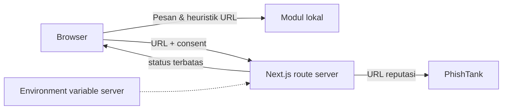

# Keamanan & Privasi

## Ringkasan pemrosesan

| Data | Lokasi proses | Dikirim eksternal | Persistensi |
|---|---|---|---|
| Pesan | Browser | Tidak | Memori React saja |
| URL heuristik | Browser | Tidak | Memori React saja |
| URL reputasi | Route server setelah consent | PhishTank | Tidak disimpan oleh aplikasi |
| Nomor | Browser | Tidak pada mode saat ini | Memori React saja |

## Prinsip privasi

Saring dirancang **privacy-first**. Fitur utama (Periksa) berjalan sepenuhnya di
peramban pengguna menggunakan aturan deterministik lokal.

Apa yang **tidak** dilakukan:

- Isi pesan tidak dikirim ke server, penyedia AI, layanan analitik, log, atau pihak ketiga.
- URL hanya dikirim ke PhishTank jika pengguna memberi consent eksplisit; jangan kirim URL pribadi yang memuat token sesi.
- Tidak menyimpan isi pesan di `localStorage`, `sessionStorage`, cookie,
  database, atau log.
- Tidak meminta akun, email, nomor telepon, identitas, atau profil media sosial.
- Tidak memasang pelacak/analitik secara bawaan.

State analisis hanya berada di memori React dan hilang saat halaman dimuat
ulang. Tombol "Bersihkan" menghapus tampilan analisis secara eksplisit.

Sejak langkah pertama, antarmuka analisis menampilkan pemberitahuan privasi di
samping area input dan mengingatkan pengguna untuk **tidak** menempelkan kata
sandi/OTP/PIN/data pribadi yang sebenarnya.

## Header keamanan

`next.config.ts` menetapkan header berikut pada semua respons (produksi):

- `X-Frame-Options: DENY`
- `X-Content-Type-Options: nosniff`
- `Referrer-Policy: strict-origin-when-cross-origin`
- `X-Permitted-Cross-Domain-Policies: none`
- `X-DNS-Prefetch-Control: off`
- `Permissions-Policy: camera=(), microphone=(), geolocation=()`
- `Content-Security-Policy` (hanya `NODE_ENV=production`): `default-src 'self'`,
  `script-src 'self' 'unsafe-inline'`, `style-src 'self' 'unsafe-inline'`,
  `img-src 'self' data: blob:`, `font-src 'self' data:`, `connect-src 'self'`,
  `frame-ancestors 'none'`, `base-uri 'self'`, `form-action 'self'`,
  `object-src 'none'`.

CSP **tidak** diterapkan pada `next dev` karena runtime pengembangan memerlukan
`eval`/inline script; penerapan di dev akan memblokir hidrasi.

## Kebijakan variabel lingkungan

- Tidak ada secret yang diperlukan untuk menjalankan aplikasi.
- Tidak ada `NEXT_PUBLIC_*` yang bernilai rahasia.
- `.env*` sudah di-`.gitignore`.
- Tidak ada kunci API frontend/backend dalam kode sumber.

## Tautan eksternal

Seluruh tautan eksternal (sumber OJK) memakai `rel="noopener noreferrer"` dan
`target="_blank"` untuk mencegah `window.opener` dan kebocoran referrer.
Pinjaman tautan resmi ditandai dengan jelas sebagai "tautan eksternal".

## Model ancaman & batasan

Aplikasi ini adalah alat bantu keputusan, bukan pengganti investigasi resmi,
bank, penyedia layanan, atau aparat penegak hukum. Analisis heuristik dapat
menghasilkan positif/negatif palsu dan bukan bukti kesalahan maupun jaminan
keamanan.