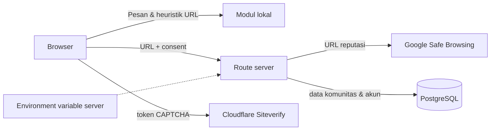

# Keamanan & Privasi

## Ringkasan pemrosesan

| Data | Lokasi proses | Dikirim eksternal | Persistensi |
|---|---|---|---|
| Pesan | Browser | Tidak | Memori React saja |
| URL heuristik | Browser | Tidak | Memori React saja |
| URL reputasi | Route server setelah consent | Google Safe Browsing | Cache singkat di memori proses |
| Nomor | Browser | Tidak | Memori React saja |
| Akun (email, nama tampilan, hash kata sandi) | Server | Tidak | PostgreSQL |
| Konten komunitas, pengajuan artikel, laporan | Server | Tidak | PostgreSQL |
| Token Turnstile | Server (Siteverify) | Cloudflare | Tidak disimpan |

## Prinsip privasi

Fitur utama (Periksa) berjalan sepenuhnya di peramban pengguna menggunakan
aturan deterministik lokal.

Apa yang **tidak** dilakukan:

- Isi pesan tidak dikirim ke server, penyedia AI, layanan analitik, log, atau pihak ketiga.
- URL hanya dikirim ke Google Safe Browsing setelah pengguna memberi consent eksplisit. Jangan memeriksa URL pribadi yang memuat token sesi.
- Isi pesan tidak disimpan di `localStorage`, `sessionStorage`, cookie, database, atau log.
- Tidak memasang pelacak/analitik secara bawaan.

Sejak langkah pertama, antarmuka analisis menampilkan pemberitahuan privasi dan
mengingatkan pengguna untuk **tidak** menempelkan kata sandi/OTP/PIN/data
pribadi yang sebenarnya.

## Data yang disimpan saat pengguna membuat akun

Akun hanya diperlukan untuk menulis di Komunitas atau mengajukan artikel.
Pemeriksaan pesan, nomor, dan tautan tetap dapat dipakai tanpa akun.

| Tabel | Isi | Tidak berisi |
|---|---|---|
| `users` | email, nama tampilan, hash kata sandi (bcrypt cost 12), role, waktu dibuat | kata sandi mentah, nomor telepon, identitas |
| `threads` / `replies` | judul, kategori, isi, penulis, status disembunyikan | data pribadi yang diminta aplikasi |
| `submissions` | artikel kontribusi + status tinjauan + catatan admin | versi draf yang tidak dikirim |
| `reports` | alasan laporan, keterangan, status | identitas pelapor pada tampilan publik |
| `moderation_log` | aksi admin, target, catatan | isi pesan pemeriksaan |
| `rate_limits` | nama bucket + penghitung + awal jendela | isi konten, token, IP mentah |

Isi halaman Periksa **tidak pernah** ditulis ke tabel mana pun.

## Header keamanan

`next.config.ts` menetapkan header berikut pada semua respons:

- `X-Frame-Options: DENY`
- `X-Content-Type-Options: nosniff`
- `Referrer-Policy: strict-origin-when-cross-origin`
- `X-Permitted-Cross-Domain-Policies: none`
- `X-DNS-Prefetch-Control: off`
- `Permissions-Policy: camera=(), microphone=(), geolocation=(), payment=()`
- `Cross-Origin-Opener-Policy: same-origin`

Pada `NODE_ENV=production` ditambahkan:

- `Content-Security-Policy`: `default-src 'self'`, `script-src 'self' 'unsafe-inline' https://challenges.cloudflare.com`, `style-src 'self' 'unsafe-inline'`, `img-src 'self' data: blob:`, `font-src 'self' data:`, `connect-src 'self' https://challenges.cloudflare.com`, `frame-src https://challenges.cloudflare.com`, `frame-ancestors 'none'`, `base-uri 'self'`, `form-action 'self'`, `object-src 'none'`, `upgrade-insecure-requests`.
- `Strict-Transport-Security` **hanya** bila `SARING_ENABLE_HSTS=1` (setelah HTTPS stabil).

`unsafe-inline` pada `script-src` masih diperlukan karena Next.js menyisipkan
skrip inline untuk data halaman. CSP tidak diterapkan pada `next dev` karena
runtime pengembangan memerlukan `eval`.

Halaman privat dan seluruh `/api/*` mengirim `Cache-Control: private, no-store`.

## Autentikasi dan sesi

- Sesi memakai `iron-session`: cookie `saring_session` yang **terenkripsi dan
  ditandatangani**, `httpOnly`, `SameSite=Lax`, dan `Secure` pada production.
- `SESSION_SECRET` minimal 32 karakter. Tanpa itu, production menolak berjalan.
- Kata sandi di-hash dengan bcrypt cost 12. Tidak ada kata sandi mentah yang
  disimpan atau dicatat.
- Login memakai perbandingan hash tiruan saat email tidak ditemukan, sehingga
  waktu respons tidak membocorkan keberadaan akun. Pesan gagal login bersifat
  umum.
- Role **selalu** dibaca ulang dari database pada setiap request
  (`requireUser`/`requireAdmin`), bukan dari klaim di cookie. Menurunkan role
  langsung berlaku pada request berikutnya.
- Registrasi selalu membuat role `user`. Pengguna tidak dapat mengirim atau
  menaikkan role sendiri; hanya admin yang dapat mengubah role lewat
  `/api/admin/moderate`, dan admin tidak dapat mengubah role akunnya sendiri.

## Otorisasi per operasi

| Operasi | Pemeriksaan server |
|---|---|
| Membuat diskusi/balasan | `requireUser` + rate limit + CAPTCHA |
| Mengirim/mengubah artikel | `requireUser` + kepemilikan (`author_id`) + status bukan final + rate limit + CAPTCHA |
| Melaporkan konten | `requireUser` + target harus ada + anti-duplikat + rate limit + CAPTCHA |
| Semua aksi admin | `requireAdmin` + rate limit + validasi skema |
| Melihat `/akun` | `getCurrentUser`, data difilter `author_id` |
| Melihat `/admin/*` | `getCurrentUser` + `role === "admin"` (404 untuk non-admin) |

Pemeriksaan kepemilikan (mencegah IDOR) dilakukan di kueri (`where id = $1 and
author_id = $2`), bukan hanya di UI.

## CSRF

- Semua endpoint mutasi memeriksa `Origin` dan `Sec-Fetch-Site` melalui
  `isSameOrigin()`. Request lintas situs ditolak dengan 403.
- Cookie sesi memakai `SameSite=Lax` sebagai lapisan pertama.
- Semua mutasi memakai `POST`/`PATCH` dengan body JSON, bukan `GET`.

## Rate limiting

Penghitung disimpan pada tabel `rate_limits` di PostgreSQL sehingga berlaku
lintas instance (bukan in-memory). Bila penyimpanan gagal, request **ditolak**
(fail closed).

| Bucket | Batas | Jendela |
|---|---|---|
| `login` | 8 | 5 menit |
| `register` | 5 | 1 jam |
| `thread-create` | 5 | 10 menit |
| `reply-create` | 20 | 10 menit |
| `submission-create` | 4 | 1 jam |
| `submission-update` | 10 | 1 jam |
| `report-create` | 10 | 1 jam |
| `url-check` | 40 | 5 menit |
| `admin-moderate` | 60 | 5 menit |

Identitas klien hanya diambil dari header yang ditulis proxy tepercaya
(`SARING_TRUST_PROXY=cloudflare` → `cf-connecting-ip`; `heroku` → hop terakhir
`x-forwarded-for`). Tanpa konfigurasi itu, semua request masuk satu bucket
`unknown` agar header palsu tidak dapat dipakai menghindari limit.

## CAPTCHA (Cloudflare Turnstile)

- Token diverifikasi **di server** melalui Siteverify. Klaim sukses dari browser
  tidak pernah dipercaya.
- Token kosong, terlalu panjang, kedaluwarsa, gagal, atau untuk action berbeda
  ditolak. Kegagalan verifikasi tidak meloloskan operasi.
- Secret hanya dibaca di server (`CLOUDFLARE_TURNSTILE_SECRET_KEY`). Bila kosong,
  operasi terlindungi **ditolak** (fail closed); UI menampilkan pemberitahuan.
- `SARING_TURNSTILE_BYPASS=1` hanya berlaku di luar production.
- CAPTCHA bukan satu-satunya lapisan: setiap endpoint terlindungi tetap memiliki
  rate limit.

## Logging

- Error server dicatat melalui `logServerError()` yang hanya menulis nama error
  dan pesan yang sudah diredaksi (pola `password=`, `token=`, URL koneksi, dan
  string acak panjang diganti `[redacted]`), dipotong 200 karakter.
- Body request, cookie, token CAPTCHA, kata sandi, API key, dan isi pesan
  pengguna tidak pernah dicatat.
- Klien hanya menerima pesan umum; `HttpError` yang sengaja aman ditampilkan apa
  adanya. Error boundary UI hanya menampilkan `error.digest`.

## Health check

`GET /api/health` menjalankan kueri ringan ke database dengan timeout 2 detik dan
mengembalikan `200` atau `503`. Endpoint tidak mengembalikan versi server, host,
nama database, atau pesan error.

## Model ancaman & batasan

Aplikasi ini adalah alat bantu keputusan, bukan pengganti investigasi resmi,
bank, penyedia layanan, atau aparat penegak hukum. Analisis heuristik dapat
menghasilkan positif/negatif palsu dan bukan bukti kesalahan maupun jaminan
keamanan.

Proteksi Cloudflare (WAF, DDoS, rate limiting edge) hanya berlaku setelah domain
di-proxy melalui Cloudflare. Selama itu belum dikonfigurasi, proteksi yang
berlaku hanyalah lapisan aplikasi yang dijelaskan di atas.
