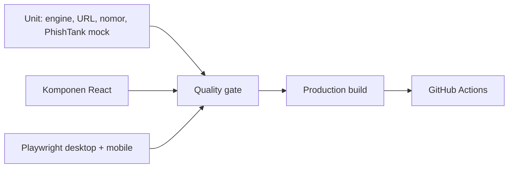

# Pengujian

## Peta lapisan pengujian



| Area | File | Status |
|---|---|---|
| Rule engine dan URL | `tests/unit/analysis.test.ts` | Lulus |
| Normalisasi nomor | `tests/unit/phone.test.ts` | Lulus |
| PhishTank adapter mock | `tests/unit/phishtank.test.ts` | Lulus; bukan live test |
| Analyzer, simulator, guide | `tests/components/*.test.tsx` | Lulus |
| Rute dan mobile | `tests/e2e/app.spec.ts` | 14 lulus, 2 dilewati |
| Provider live | Belum ada | Menunggu credential/valid smoke test |

## Perintah

```bash
npm run lint        # ESLint
npm run typecheck   # tsc --noEmit
npm run test        # Vitest: unit + komponen (jsdom)
npm run test:e2e    # Playwright: membangun lalu mengetes server produksi
npm run build       # produksi build
```

## Cakupan

### Unit (`tests/unit/analysis.test.ts`)

Menguji mesin aturan tanpa peramban:

1. Pesan permintaan OTP → temuan `credential-theft`.
2. Biaya rekrutmen → temuan `upfront-payment` beserta penjelasan.
3. Janji untung pasti → temuan `unrealistic-promise`.
4. Pesan netral → klasifikasi `limited-signals`.
5. Input kosong → `isValid: false` + pesan error.
6. Penyebutan "OTP" dalam konteks edukasi → **tidak** ditandai kredensial.
7. URL penyingkat/IP diperiksa **tanpa** memanggil `fetch` (spyon global `fetch`).
8. Instruksi transaksi di luar platform → temuan `risky-instruction`.
9. Klasifikasi multi-sinyal → `many-signals`.
10. Input melebihi batas karakter → error.

### Komponen (`tests/components/`)

- `simulator.test.tsx` — umpan balik bergantung pilihan; urutan lengkap ke ringkasan.
- `guide.test.tsx` — setiap situasi menampilkan panduan yang sesuai; sumber OJK tampil.
- `analyzer.test.tsx` — validasi input kosong; hasil tanpa menulis ke storage.

### End-to-end (`tests/e2e/`)

- `app.spec.ts` — kelima rute dimuat langsung tanpa 404; alur analisis nyata;
  kontrol & pemberitahuan tetap berfungsi di viewport seluler; menu seluler terbuka.

Playwright menjalankan server produksi (`npm run build && npm run start`),
bukan server dev, agar menguji artefak yang benar-benar digunakan saat rilis.

## CI (GitHub Actions)

`.github/workflows/ci.yml` menjalankan pada push/PR:

1. Job `quality`: `npm ci` → lint → typecheck → test → build.
2. Job `e2e` (setelah `quality`): `npm ci` → `playwright install chromium` → `test:e2e`.

## Catatan pemetaan ke daftar QA

- "Pesan dianalisis tidak ditulis ke browser storage" → spy `Storage.setItem` di
  `analyzer.test.tsx` dan menegaskan tidak dipanggil.
- "Tautan diperiksa tanpa difetch" → spy global `fetch` di unit test.
- "Kontrol penting di viewport seluler" → proyek `mobile` Playwright (Pixel 5).