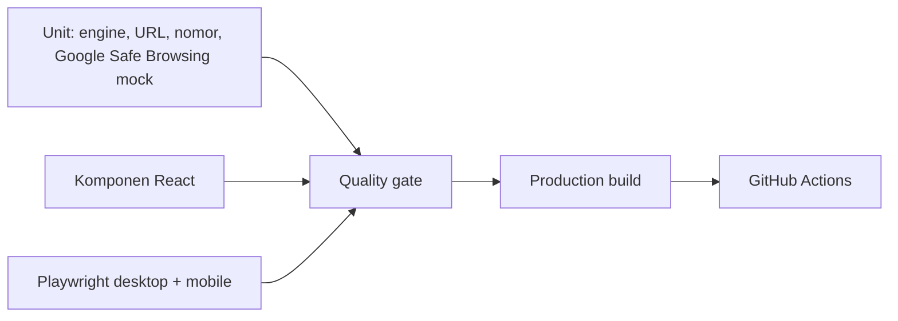

# Pengujian

## Peta lapisan pengujian



| Area | File | Status |
|---|---|---|
| Rule engine dan URL | `tests/unit/analysis.test.ts` | Lulus |
| Normalisasi nomor | `tests/unit/phone.test.ts` | Lulus |
| Google Safe Browsing adapter mock | `tests/unit/googleSafeBrowsing.test.ts` | Lulus; live diuji terpisah |
| Decoder protobuf | `tests/unit/gsbProtobuf.test.ts` | Lulus, memakai byte nyata |
| Data Pustaka (14 artikel) | `tests/unit/resources.test.ts` | Lulus |
| Bank skenario dan skor | `tests/unit/scenarios.test.ts` | Lulus |
| Grid Pustaka dan filter | `tests/components/library.test.tsx` | Lulus |
| Simulator dan ringkasan | `tests/components/simulator.test.tsx` | Lulus |
| Rencana tindakan | `tests/components/guide.test.tsx` | Lulus |
| Analyzer dan mode checker | `tests/components/analyzer.test.tsx`, `checker-modes.test.tsx` | Lulus |
| Rute, Pustaka, Latihan, Langkah, mobile | `tests/e2e/app.spec.ts` | Lulus |
| Turnstile (Siteverify) | `tests/unit/turnstile.test.ts` | Lulus |
| Rate limit dan identitas klien | `tests/unit/rate-limit.test.ts` | Lulus |
| Pemeriksaan origin/CSRF | `tests/unit/origin.test.ts` | Lulus |
| Penjaga autentikasi dan role | `tests/unit/guards.test.ts` | Lulus |
| Endpoint moderasi admin | `tests/unit/admin-route.test.ts` | Lulus |
| Endpoint komunitas + CAPTCHA + rate limit | `tests/unit/community-route.test.ts` | Lulus |
| Aturan publikasi artikel | `tests/unit/publication.test.ts` | Lulus |
| Kepemilikan data dan laporan | `tests/unit/ownership.test.ts` | Lulus |
| Versioning artikel publik + revisi | `tests/unit/revisions.test.ts` | Lulus |
| Aksi admin menyetujui/menolak revisi | `tests/unit/revision-review.test.ts` | Lulus |
| Draf, bookmark, notifikasi (route) | `tests/unit/engagement.test.ts` | Lulus |
| Kategori pertanyaan "Lainnya" | `tests/unit/thread-category.test.ts` | Lulus |
| Adapter media lintas hosting | `tests/unit/media.test.ts` | Lulus |
| UI, revisi, autosave, bookmark, notifikasi (E2E) | `tests/e2e/v16.spec.ts` | Lulus |
| Kontras tiga mode tema dari warna terhitung (E2E) | `tests/e2e/contrast.spec.ts` | Lulus |

## Tema dan keterbacaan

| Berkas | Cakupan |
|---|---|
| `scripts/contrast-audit.mjs` | Kontras pasangan token (teks normal 4,5:1, batas kontrol dan cincin fokus 3:1) untuk palet terang dan gelap, ditambah pemeriksaan bahwa dua blok palet gelap identik dan lengkap. |
| `tests/e2e/contrast.spec.ts` | Kontras `color`/`background-color` hasil komputasi pada 19 rute × 4 mode, warna aksen, panel notifikasi, dan perilaku pemilih tema. |
| `tests/unit/archive*.test.ts` | Aturan arsip artikel (pemilik/admin) dan hilangnya artikel dari Pustaka. |

Yang diperiksa oleh `tests/e2e/contrast.spec.ts`:

- **4 mode** — `system-terang`, `system-gelap`, `manual-terang`, `manual-gelap`.
  Setiap rute juga diverifikasi warna latar `body`-nya, sehingga mode yang tidak
  benar-benar aktif tidak bisa lolos.
- **Permukaan interaktif** — editor berisi teks, dialog media, panel notifikasi,
  form masuk, pencarian Pustaka, dan menu navigasi mobile.
- **Batas kontrol dan placeholder** — isian latar kontrol berbeda >=3:1 dari
  latar sekitar atau border >=3:1; placeholder >=4,5:1.
- **Pemilih tema** — berada di `/akun` (bukan di navigasi). Default pengunjung
  baru adalah **Terang** (tidak mengikuti OS); preferensi tersimpan `dark`,
  `light`, maupun `system` tetap dihormati, bertahan setelah reload, dan
  `Ikuti sistem` mengikuti pengaturan OS. Preferensi hanya di `localStorage`
  (`saring.theme`); HTML dari server tidak memuat atribut `data-theme`.
- **Tanpa kilatan tema** — `data-theme` terpasang sebelum `first-paint`
  (direkam lewat `MutationObserver` dan `PerformanceObserver`), termasuk untuk
  pengunjung baru pada sistem gelap.
- **Aksen** — aksen kuat (lime, coral, amber, safe) tetap berona dan kontras di
  kedua tema; latar aksen lembut tidak menjadi abu-abu dan tetap terpisah dari
  aksen kuatnya.
- **Panel notifikasi** — sepenuhnya di dalam viewport desktop dan mobile, tidak
  tertutup elemen lain, dapat ditutup dengan Escape dan klik di luar, dan hanya
  satu permintaan notifikasi meskipun varian desktop dan mobile sama-sama
  dirender.
- **Stabilitas** — tidak ada peringatan hydration dan tidak ada overflow
  horizontal.

Catatan metodologi: Tailwind v4 mengeluarkan warna dengan opacity sebagai
`oklab(...)`; audit mengonversinya ke sRGB. Tanpa konversi itu, elemen beropacity
(navbar, footer, badge) akan lolos secara palsu.


## Media, revisi, dan interaksi komunitas

- **Media lintas hosting**: gambar `i.postimg.cc`, `i.ibb.co`, `images2.imgbox.com`
  dan host HTTPS lain diterima; URL halaman galeri (postimg/imgbox/ibb) ditolak
  dengan petunjuk; host yang menyerupai provider (`imgur.com.evil.test`) ditolak;
  BBCode `[img]`, HTML ``, dan kode embed resmi diurai tanpa menyimpan script.
- **Versioning artikel**: revisi pending tidak mengubah artikel publik; persetujuan
  mengganti versi publik dan mempertahankan slug; penolakan/permintaan perbaikan
  tidak menghapus artikel tayang; revisi tidak dapat diterbitkan dua kali.
- **Draf**: upsert satu draf per jenis/target; `bodyJson` tetap melewati allowlist;
  draf hanya terbaca pemiliknya; penghapusan draf orang lain ditolak.
- **Bookmark**: artikel bawaan dan kontribusi `approved` diterima, artikel pending
  ditolak, tidak ada duplikat, penghapusan hanya milik sendiri.
- **Notifikasi**: dibuat dari balasan nyata, tidak untuk balasan pada pertanyaan
  sendiri, idempoten, dan tidak dapat dibaca/diubah pengguna lain.
- **Kategori `Lainnya`**: default form, diterima validasi server, tersimpan, dan
  dapat difilter tanpa mengubah kategori pertanyaan lama.
- **UI**: editor tidak meluap dengan URL panjang (desktop & mobile), search bar
  Pustaka bergaris empat sisi di mode terang dan gelap, dan warna mengikuti
  preferensi sistem secara default.

| Validasi & sanitasi konten kaya | `tests/unit/rich-text.test.ts` | Lulus |
| Endpoint pengajuan artikel (konten, IDOR, status) | `tests/unit/submission-route.test.ts` | Lulus |
| Kontrak penyimpanan `body_json` | `tests/unit/article-persistence.test.ts` | Lulus |
| Renderer konten kaya & XSS | `tests/components/rich-content.test.tsx` | Lulus |
| Editor Tiptap: toolbar, format, tautan | `tests/components/rich-text-editor.test.tsx` | Lulus |
| Editor artikel end-to-end (PostgreSQL + Pustaka) | `tests/e2e/article-editor.spec.ts` | Lulus |

## Editor artikel

- **Ukuran area menulis**: tinggi `#artikel-editor` ≥ 360 px di desktop dan ≥ 280
  px di mobile walaupun dokumen kosong; `max-height: none` dan `overflow-y:
  visible` (tidak ada kotak bergulir sendiri); tinggi bertambah saat tulisan
  memanjang; placeholder tetap tampil.
- Toolbar tampil lengkap dengan label aksesibel, dan `aria-pressed` mengikuti
  format pada posisi kursor.
- Perintah bold/italic/underline/heading/list/blockquote/link benar-benar
  mengubah dokumen editor; shortcut `Ctrl+I` berfungsi.
- Tautan berbahaya (`javascript:`) ditolak di dialog tanpa menyisipkan apa pun;
  URL tanpa protokol otomatis diberi `https://`.
- **Gambar langsung**: disisipkan lewat dialog, benar-benar termuat di browser
  (`naturalWidth > 0`), membawa `referrerpolicy="no-referrer"`, dan URL tidak
  aman (termasuk URL halaman album) ditolak.
- **Embed Imgur**: URL album `https://imgur.com/a/l4mKcOj` menjadi node
  `imgurEmbed` dengan iframe `…/embed?pub=true` yang benar-benar memuat dokumen
  Imgur berisi gambar (diverifikasi lewat frame Playwright). Kode embed resmi
  diurai tanpa menyimpan/menjalankan `<script>`. `data-id` tidak valid dan host
  palsu ditolak.
- **Tempel URL**: menempel satu URL gambar memunculkan tawaran "Jadikan gambar"
  vs "Biarkan sebagai tautan" (diuji dengan clipboard sungguhan).
- Artikel kosong ditolak dengan pesan jelas, dan tidak ada baris database dibuat.
- Media tersimpan di `submissions.body_json` (atribut hanya `src`/`alt` dan
  `id`/`kind`), tetap utuh setelah halaman dimuat ulang, dan tampil di Pustaka
  setelah disetujui — termasuk gambar yang benar-benar termuat dan tautan
  fallback Imgur yang aman.
- Embed yang gagal dimuat tetap menampilkan tautan fallback yang aman.
- `<script>` di dalam teks tetap menjadi teks pada halaman publik.
- Pengguna lain tidak dapat mengubah pengajuan (404), dan artikel final tidak
  dapat diubah (409).
- Editor tidak menimbulkan overflow horizontal pada viewport mobile.

## Keamanan dan otorisasi

- **CAPTCHA**: token kosong/bukan string/terlalu panjang ditolak tanpa memanggil
  jaringan; `success` non-boolean ditolak; action berbeda ditolak; provider error,
  non-200, JSON rusak, dan koneksi gagal menghasilkan penolakan; secret kosong
  fail closed; bypass tidak berlaku di production.
- **Rate limit**: batas tercapai → HTTP 429 dengan `Retry-After`; bucket terpisah
  per klien dan per scope; backend gagal → request ditolak; header IP hanya
  dipercaya pada mode proxy yang dikonfigurasi (nilai aneh jatuh ke `unknown`).
- **Otorisasi**: tanpa sesi → 401; pengguna biasa → 403; role dibaca ulang dari
  database sehingga penurunan role langsung berlaku; admin tidak dapat mengubah
  role akunnya sendiri (409).
- **Publikasi**: pengajuan `pending` tidak tampil; `approved` terbit dengan slug
  unik; `rejected`/`needs_revision` tidak terbit; artikel final tidak dapat
  diubah penulis; penulis lain tidak dapat mengubah pengajuan orang lain.
- **CSRF**: Origin lintas situs, `Sec-Fetch-Site: cross-site`, dan Origin tak
  terurai ditolak.


## Cakupan penting

- **Pustaka**: 14 artikel dengan slug unik, isi substantif, estimasi waktu baca
  yang mengikuti panjang teks, tautan terkait valid, dan seluruh sumber https.
- **Latihan**: 18 skenario, tepat satu opsi bernilai 100 per skenario, mode sesi
  memilih jumlah soal tanpa duplikasi, pengacak deterministik, dan `scoreSession`
  mencakup poin penuh, poin parsial, 0 poin, ringkasan kategori, serta sesi kosong.
- **Rencana tindakan**: lima bagian tampil untuk setiap kondisi, kondisi awal
  dari `?kondisi=`, dan tidak ada janji pengembalian dana.
- **Homepage**: section daftar fitur yang duplikat sudah dihapus dan diganti
  bagian "Kalau sudah terlanjur". Footer memuat batasan, bukan mengulang
  prinsip privasi.
- **Mobile**: tidak ada overflow horizontal pada seluruh rute utama.

## Perintah

```bash
npm run lint        # ESLint
npm run typecheck   # tsc --noEmit
npm run test        # Vitest: unit + komponen (jsdom)
npm run test:e2e    # Playwright: membangun lalu mengetes server produksi
npm run build       # produksi build
npm run audit:contrast   # kontras token light/dark (WCAG 2.2 AA)
```

## Prasyarat pengujian end-to-end

Semua berkas E2E memakai **PostgreSQL sungguhan** (bukan mock/in-memory) karena
yang diuji adalah persistensi artikel, revisi, draf autosave, bookmark, dan
notifikasi. `playwright.config.ts` memuat `.env.local` sebelum konfigurasi
dibaca, lalu **melempar pesan yang jelas** bila `DATABASE_URL` tidak diset —
sebelumnya ketiadaannya hanya muncul sebagai `ECONNREFUSED ::1:5432`.

Langkah lokal:

1. Buat database uji terpisah (jangan memakai database pengembangan/produksi):

   ```bash
   createdb saring_test        # atau buat lewat pgAdmin/psql
   export DATABASE_URL="postgresql://<user>:<pass>@127.0.0.1:5432/saring_test"
   export DATABASE_SSL=disable
   npm run db:migrate
   ```

2. `npm run test:e2e` — Playwright membangun lalu menjalankan server produksi
   (`next build && next start`) dengan environment yang sama.

Data uji dibuat dengan awalan unik (`editor-e2e-…`, `v16-…`) lalu dihapus di
`afterAll`.

`playwright.config.ts` juga menyetel **kunci uji resmi Cloudflare Turnstile**
(`1x00000000000000000000AA` / `1x0000000000000000000000000000000AA`) pada proses
`webServer`. Siteverify tetap dipanggil sungguhan: autentikasi, CAPTCHA, dan
validasi tidak dimatikan.

Catatan untuk database bersama: bila role database tidak boleh membuat database
baru, E2E dapat diarahkan ke schema terpisah lewat parameter `options`
(`-c search_path=<schema>`), sehingga tabel `public` tidak tersentuh.

## Cakupan

### Unit (`tests/unit/analysis.test.ts`)

Menguji mesin aturan tanpa peramban:

1. Pesan permintaan OTP → temuan `credential-theft`.
2. Biaya rekrutmen → temuan `upfront-payment` beserta penjelasan.
3. Janji untung pasti → temuan `unrealistic-promise`.
4. Pesan netral → klasifikasi `limited-signals`.
5. Input kosong → `isValid: false` + pesan error.
6. Penyebutan "OTP" dalam konteks edukasi → **tidak** ditandai kredensial.
7. URL penyingkat/IP diperiksa **tanpa** memanggil `fetch` (spyon global `fetch`).
8. Instruksi transaksi di luar platform → temuan `risky-instruction`.
9. Klasifikasi multi-sinyal → `many-signals`.
10. Input melebihi batas karakter → error.

### Komponen (`tests/components/`)

- `simulator.test.tsx`. umpan balik bergantung pilihan; urutan lengkap ke ringkasan.
- `guide.test.tsx`. setiap situasi menampilkan panduan yang sesuai; sumber OJK tampil.
- `analyzer.test.tsx`. validasi input kosong; hasil tanpa menulis ke storage.

### End-to-end (`tests/e2e/`)

- `app.spec.ts`. kelima rute dimuat langsung tanpa 404; alur analisis nyata;
  kontrol & pemberitahuan tetap berfungsi di viewport seluler; menu seluler terbuka.

Playwright menjalankan server produksi (`npm run build && npm run start`),
bukan server dev, agar menguji artefak yang benar-benar digunakan saat rilis.

## CI (GitHub Actions)

`.github/workflows/ci.yml` menjalankan pada push/PR:

1. Job `quality`: `npm ci` → lint → typecheck → test → build.
2. Job `e2e` (setelah `quality`, butuh job pertama hijau):
   - service container `postgres:16.15` dengan health check `pg_isready`
     (retry 20×, `--health-start-period 10s`),
   - pengaman yang menolak jalan bila `DATABASE_URL` bukan database uji lokal,
   - health check tambahan memakai driver `pg` (bukan hanya port TCP),
   - `npm run db:migrate` lalu `npm run db:migrate:status`,
   - `npm run test:e2e`,
   - unggah `test-results`/`playwright-report` bila gagal.

Penyebab kegagalan E2E sebelumnya: job E2E tidak menyediakan database dan tidak
menyetel `DATABASE_URL`, sehingga pool `pg` mencoba `localhost:5432` dan gagal
dengan `ECONNREFUSED ::1:5432` / `127.0.0.1:5432`. Workflow sekarang
menyediakan database sementara khusus CI, menerapkan migration ke database itu,
dan menjalankan server yang diuji dengan environment yang sama.

Environment job E2E (nilai dummy khusus CI, bukan produksi):

| Variabel | Nilai |
|---|---|
| `DATABASE_URL` | `postgresql://saring:<dummy>@127.0.0.1:5432/saring_test` |
| `DATABASE_SSL` | `disable` |
| `SESSION_SECRET` | string acak 64 karakter khusus CI |
| Turnstile | kunci uji resmi Cloudflare (`1x…AA`) |

Workflow tidak pernah memakai database lokal pengguna, tidak memakai database
produksi, dan tidak menonaktifkan autentikasi/CAPTCHA/validasi. Migration hanya
diterapkan ke container sementara yang dihapus setelah job selesai.


## Catatan pemetaan ke daftar QA

- "Pesan dianalisis tidak ditulis ke browser storage" → spy `Storage.setItem` di
  `analyzer.test.tsx` dan menegaskan tidak dipanggil.
- "Tautan diperiksa tanpa difetch" → spy global `fetch` di unit test.
- "Kontrol penting di viewport seluler" → proyek `mobile` Playwright (Pixel 5).